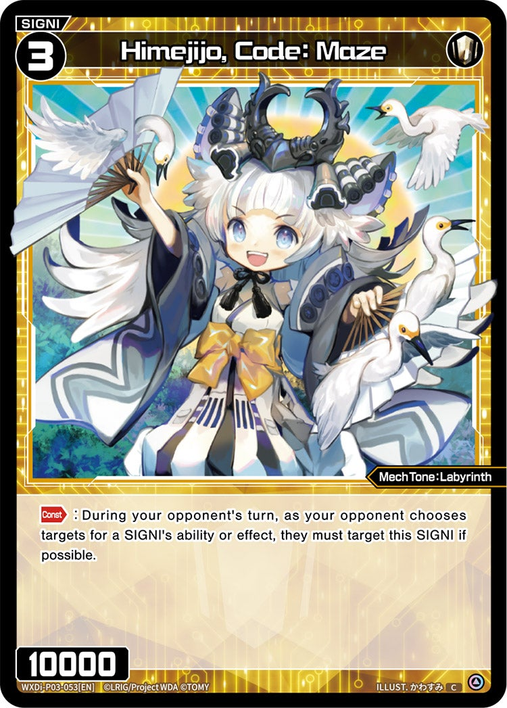

# Himejijo, Code: Maze

## Thông tin lá

| Trường | Giá trị |
| --- | --- |
| Mã in | WXDi-P03-053[EN] |
| Set | WXDi-P03[EN] |
| Số thứ tự | 053 |
| Loại thẻ | SIGNI |
| Vị trí | Main Deck |
| Số bản | — (set booster, không áp dụng) |
| Màu | Trắng |
| Độ hiếm | C,C(P) |
| Minh họa | かわすみ |
| Level | 3 |
| Limit | — |
| Power | 10000 |
| LRIG type / Class | Mech Tone：Labyrinth |
| Team / Master | — |
| Cost | — |
| Grow cost | — |
| Use timing | — |
| Life Burst | Không |

## Card text chính thức

[Constant]: During your opponent's turn, as your opponent chooses targets for a SIGNI's ability or effect, they must target this SIGNI if possible.

## Power text / Life Burst

—

## Ghi chú minh họa
Artist: かわすみ. Ảnh C được tải từ Card List tiếng Anh.

## FAQ chính thức

**Q. What exactly is [Constant] ability?**
A. For example, if you have "Himejijo, Code: Maze" and another SIGNI, and your opponent puts "Anna Mirage, Doomed Evil" onto the field, the effect of [Enter] ability requires your opponent to target "Himejijo, Code: Maze".
 If the ability or effect targets more than one target, "Himejijo, Code: Maze" must be targeted as one of them. If the ability or effect targets "up to 1" target, your opponent may not select "Himejijo, Code: Maze" as the target.
 The same applies to SIGNI's Life Burst ability.

## Ảnh biến thể

- [C(P)](../images/WXDi-P03-053P-EN.jpg)

## Nguồn
[Card List/FAQ chính thức](https://www.takaratomy.co.jp/products/en.wixoss/card/card.html?card_no=WXDi-P03-053%5BEN%5D ) · [Ảnh thẻ](https://www.takaratomy.co.jp/products/en.wixoss/card/thumb/WXDi-P03-053%5BEN%5D.jpg)
