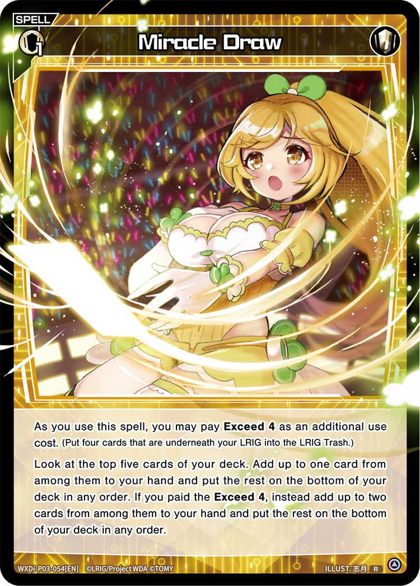

# Miracle Draw

## Thông tin lá

| Trường | Giá trị |
| --- | --- |
| Mã in | WXDi-P03-054[EN] |
| Set | WXDi-P03[EN] |
| Số thứ tự | 054 |
| Loại thẻ | SPELL |
| Vị trí | Main Deck |
| Số bản | — (set booster, không áp dụng) |
| Màu | Trắng |
| Độ hiếm | R,R(P) |
| Minh họa | 志月 |
| Level | — |
| Limit | — |
| Power | 0 |
| LRIG type / Class | — |
| Team / Master | — |
| Cost | 《W》×１ |
| Grow cost | — |
| Use timing | — |
| Life Burst | Không |

## Card text chính thức

As you use this spell, you may pay Exceed 4 as an additional use cost. (Put four cards that are underneath your LRIG into the LRIG Trash.)

Look at the top five cards of your deck. Add up to one card from among them to your hand and put the rest on the bottom of your deck in any order. If you paid the Exceed 4, instead add up to two cards from among them to your hand and put the rest on the bottom of your deck in any order.

## Power text / Life Burst

—

## Ghi chú minh họa
Artist: 志月. Ảnh R được tải từ Card List tiếng Anh.

## FAQ chính thức

**Q. After looking at five cards from the top of the deck, can I decide to pay the Exceed cost and add two of them to my hand?**
A. No, you cannot. The cost of Exceed is paid when this card is used and before you see 5 cards from the top of the deck.

**Q. What happens if I use this Spell when I have 4 or less cards left in my deck?**
A. In that case, you look at all four or fewer of its remaining cards and process the effect. If you returned one or more cards to your deck as resolving the effect, then no Refresh is performed.

## Ảnh biến thể

- [R(P)](../images/WXDi-P03-054P-EN.jpg)

## Nguồn
[Card List/FAQ chính thức](https://www.takaratomy.co.jp/products/en.wixoss/card/card.html?card_no=WXDi-P03-054%5BEN%5D ) · [Ảnh thẻ](https://www.takaratomy.co.jp/products/en.wixoss/card/thumb/WXDi-P03-054%5BEN%5D.jpg)
