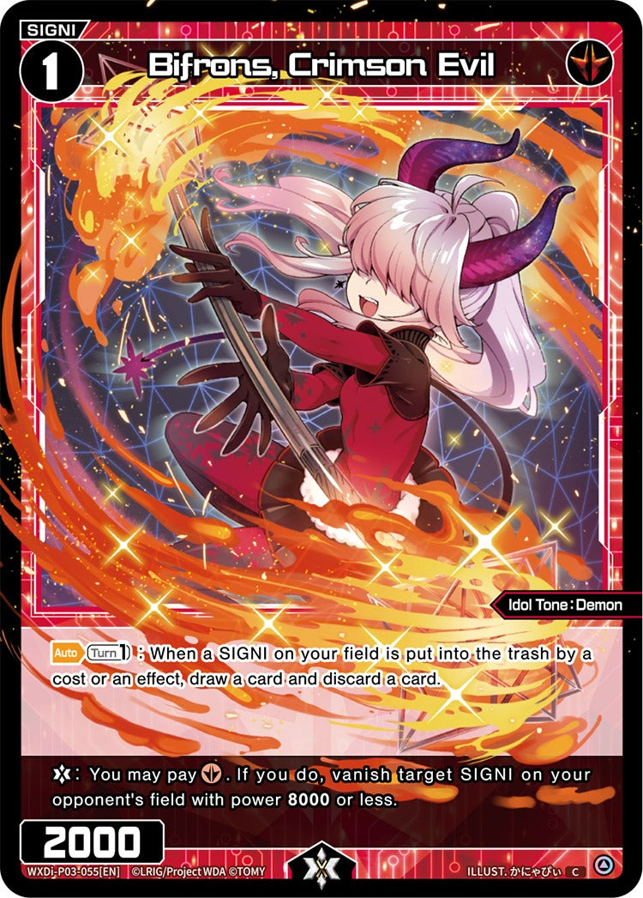

# Bifrons, Crimson Evil

## Thông tin lá

| Trường | Giá trị |
| --- | --- |
| Mã in | WXDi-P03-055[EN] |
| Set | WXDi-P03[EN] |
| Số thứ tự | 055 |
| Loại thẻ | SIGNI |
| Vị trí | Main Deck |
| Số bản | — (set booster, không áp dụng) |
| Màu | Đỏ |
| Độ hiếm | C,C(P) |
| Minh họa | かにゃぴぃ |
| Level | 1 |
| Limit | — |
| Power | 2000 |
| LRIG type / Class | Idol Tone：Demon |
| Team / Master | — |
| Cost | — |
| Grow cost | — |
| Use timing | — |
| Life Burst | Có |

## Card text chính thức

[Auto] {1/Turn}: When a SIGNI on your field is put into the trash by a cost or an effect, draw a card and discard a card.

## Power text / Life Burst

You may pay {Red}. If you do, vanish target SIGNI on your opponent's field with power 8000 or less.

## Ghi chú minh họa
Artist: かにゃぴぃ. Ảnh C được tải từ Card List tiếng Anh.

## FAQ chính thức

**Q. If this SIGNI is put into its owner's Trash from the field by a cost or effect, does the [Auto] ability trigger?**
A. Yes, it is triggered.

## Ảnh biến thể

- [C(P)](../images/WXDi-P03-055P-EN.jpg)

## Nguồn
[Card List/FAQ chính thức](https://www.takaratomy.co.jp/products/en.wixoss/card/card.html?card_no=WXDi-P03-055%5BEN%5D ) · [Ảnh thẻ](https://www.takaratomy.co.jp/products/en.wixoss/card/thumb/WXDi-P03-055%5BEN%5D.jpg)
