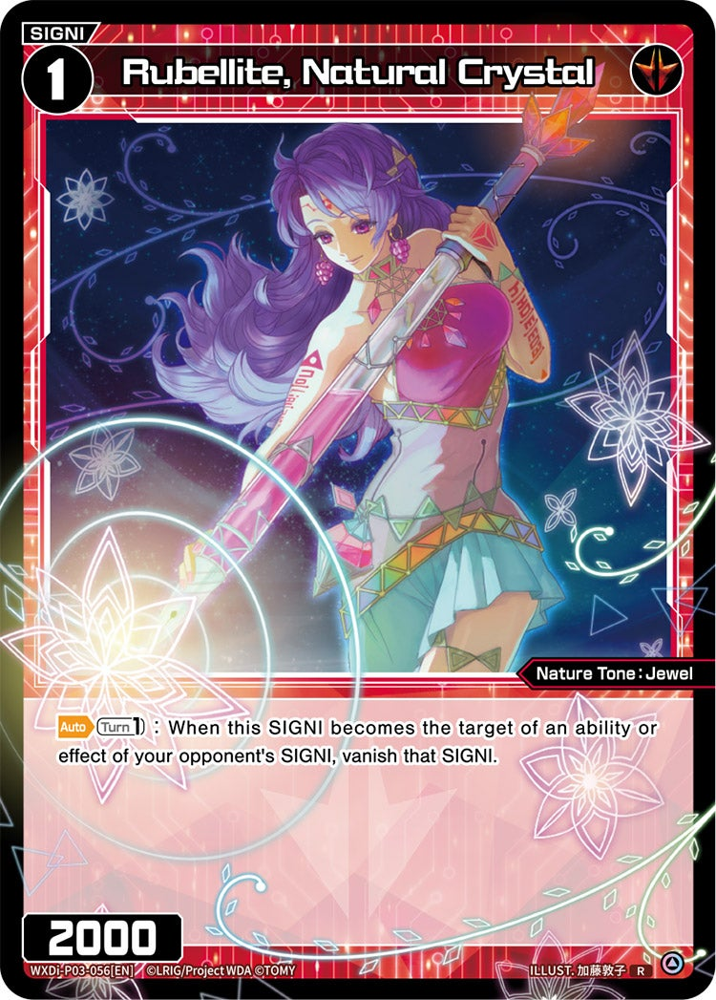

# Rubellite, Natural Crystal

## Thông tin lá

| Trường | Giá trị |
| --- | --- |
| Mã in | WXDi-P03-056[EN] |
| Set | WXDi-P03[EN] |
| Số thứ tự | 056 |
| Loại thẻ | SIGNI |
| Vị trí | Main Deck |
| Số bản | — (set booster, không áp dụng) |
| Màu | Đỏ |
| Độ hiếm | R,R(P) |
| Minh họa | 加藤敦子 |
| Level | 1 |
| Limit | — |
| Power | 2000 |
| LRIG type / Class | Nature Tone：Jewel |
| Team / Master | — |
| Cost | — |
| Grow cost | — |
| Use timing | — |
| Life Burst | Không |

## Card text chính thức

[Auto] {1/Turn}: When this SIGNI becomes the target of an ability or effect of your opponent's SIGNI, vanish that SIGNI.

## Power text / Life Burst

—

## Ghi chú minh họa
Artist: 加藤敦子. Ảnh R được tải từ Card List tiếng Anh.

## FAQ chính thức

**Q. What exactly is the effect of [Auto] ability?**
A. It is triggered when this SIGNI is targeted by an ability or effect of an opponent's SIGNI.
 For example, if this SIGNI is targeted by your opponent's SIGNI's [Enter] ability, it will trigger after that opponent's SIGNI's ability is processed.
 Even if it is a vanishing effect, the ability is still triggered, so it will process after this SIGNI is vanished, vanishing the opponent's SIGNI.

**Q. My opponent's SIGNI with [Shadow] targeted this SIGNI with its ability. What happens?**
A. This [Auto] ability does not choose the target, so even a SIGNI with [Shadow] can be vanished.

## Ảnh biến thể

- [R(P)](../images/WXDi-P03-056P-EN.jpg)

## Nguồn
[Card List/FAQ chính thức](https://www.takaratomy.co.jp/products/en.wixoss/card/card.html?card_no=WXDi-P03-056%5BEN%5D ) · [Ảnh thẻ](https://www.takaratomy.co.jp/products/en.wixoss/card/thumb/WXDi-P03-056%5BEN%5D.jpg)
