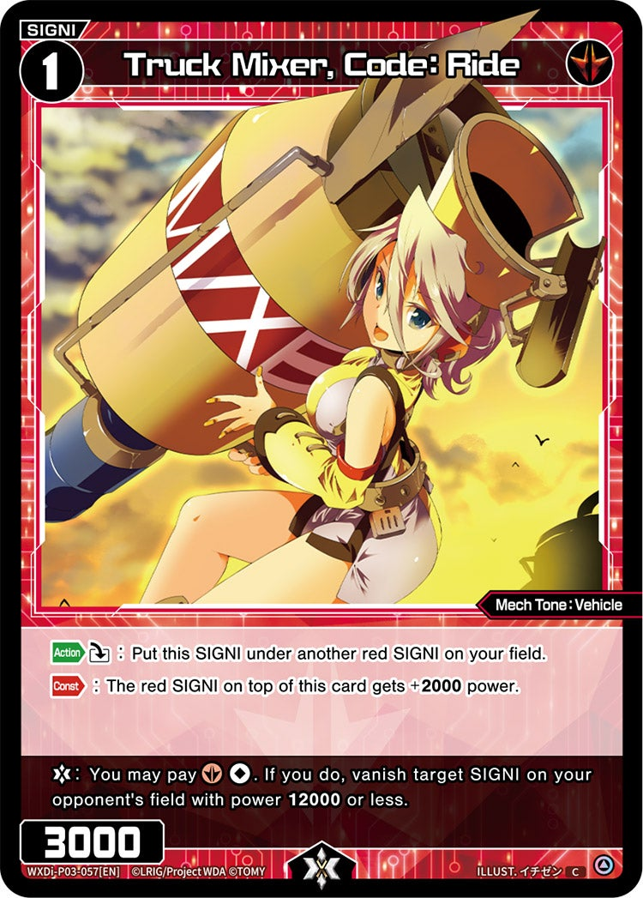

# Truck Mixer, Code: Ride

## Thông tin lá

| Trường | Giá trị |
| --- | --- |
| Mã in | WXDi-P03-057[EN] |
| Set | WXDi-P03[EN] |
| Số thứ tự | 057 |
| Loại thẻ | SIGNI |
| Vị trí | Main Deck |
| Số bản | — (set booster, không áp dụng) |
| Màu | Đỏ |
| Độ hiếm | C,C(P) |
| Minh họa | イチゼン |
| Level | 1 |
| Limit | — |
| Power | 3000 |
| LRIG type / Class | Mech Tone：Vehicle |
| Team / Master | — |
| Cost | — |
| Grow cost | — |
| Use timing | — |
| Life Burst | Có |

## Card text chính thức

[Action] {Down}: Put this SIGNI under another red SIGNI on your field.

[Constant]: The red SIGNI on top of this card gets +2000 power.

## Power text / Life Burst

You may pay {Red} {Colorless}. If you do, vanish target SIGNI on your opponent's field with power 12000 or less.

## Ghi chú minh họa
Artist: イチゼン. Ảnh C được tải từ Card List tiếng Anh.

## FAQ chính thức

— (không có FAQ riêng cho mã này trên trang FAQ tiếng Anh.)

## Ảnh biến thể

- [C(P)](../images/WXDi-P03-057P-EN.jpg)

## Nguồn
[Card List/FAQ chính thức](https://www.takaratomy.co.jp/products/en.wixoss/card/card.html?card_no=WXDi-P03-057%5BEN%5D ) · [Ảnh thẻ](https://www.takaratomy.co.jp/products/en.wixoss/card/thumb/WXDi-P03-057%5BEN%5D.jpg)
