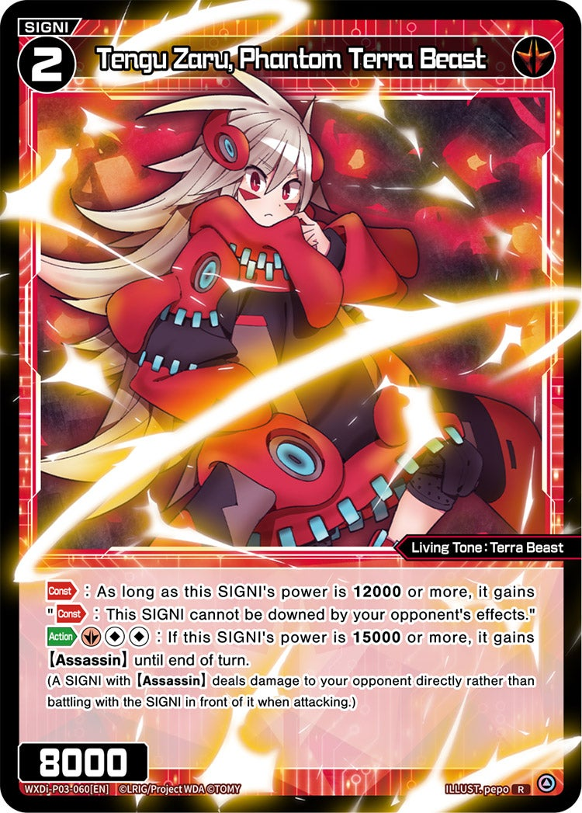

# Tengu Zaru, Phantom Terra Beast

## Thông tin lá

| Trường | Giá trị |
| --- | --- |
| Mã in | WXDi-P03-060[EN] |
| Set | WXDi-P03[EN] |
| Số thứ tự | 060 |
| Loại thẻ | SIGNI |
| Vị trí | Main Deck |
| Số bản | — (set booster, không áp dụng) |
| Màu | Đỏ |
| Độ hiếm | R,R(P) |
| Minh họa | pepo |
| Level | 2 |
| Limit | — |
| Power | 8000 |
| LRIG type / Class | Living Tone：Terra Beast |
| Team / Master | — |
| Cost | — |
| Grow cost | — |
| Use timing | — |
| Life Burst | Không |

## Card text chính thức

[Constant]: As long as this SIGNI's power is 12000 or more, it gains "[Constant]: This SIGNI cannot be downed by your opponent's effects."
[Action] {Red} {Colorless} {Colorless}: If this SIGNI's power is 15000 or more, it gains 【Assassin】 until end of turn.
(A SIGNI with 【Assassin】 deals damage to your opponent directly rather than battling with the SIGNI in front of it when attacking.)

## Power text / Life Burst

—

## Ghi chú minh họa
Artist: pepo. Ảnh R được tải từ Card List tiếng Anh.

## FAQ chính thức

**Q. I used the [Action] ability and this SIGNI gained [Assassin], but then its power became less than 15000 due to some effect. What happens to the [Assassin] it gained?**
A. By [Action] ability, the power of this SIGNI is only checked when the [Action] ability is activated, so even if the power changes later, it still gains [Assassin] in this turn.

## Ảnh biến thể

- [R(P)](../images/WXDi-P03-060P-EN.jpg)

## Nguồn
[Card List/FAQ chính thức](https://www.takaratomy.co.jp/products/en.wixoss/card/card.html?card_no=WXDi-P03-060%5BEN%5D ) · [Ảnh thẻ](https://www.takaratomy.co.jp/products/en.wixoss/card/thumb/WXDi-P03-060%5BEN%5D.jpg)
