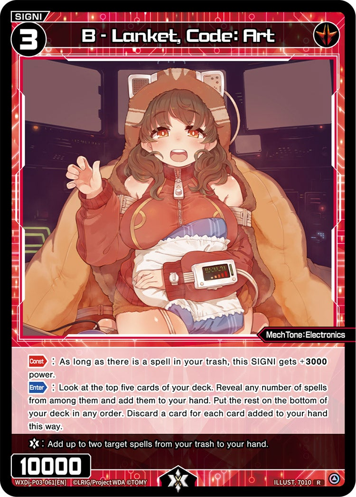

# B-Lanket, Code: Art

## Thông tin lá

| Trường | Giá trị |
| --- | --- |
| Mã in | WXDi-P03-061[EN] |
| Set | WXDi-P03[EN] |
| Số thứ tự | 061 |
| Loại thẻ | SIGNI |
| Vị trí | Main Deck |
| Số bản | — (set booster, không áp dụng) |
| Màu | Đỏ |
| Độ hiếm | R,R(P) |
| Minh họa | 7010 |
| Level | 3 |
| Limit | — |
| Power | 10000 |
| LRIG type / Class | Mech Tone：Electronics |
| Team / Master | — |
| Cost | — |
| Grow cost | — |
| Use timing | — |
| Life Burst | Có |

## Card text chính thức

[Constant]: As long as there is a spell in your trash, this SIGNI gets +3000 power.
[Enter]: Look at the top five cards of your deck. Reveal any number of spells from among them and add them to your hand. Put the rest on the bottom of your deck in any order. Discard a card for each card added to your hand this way.

## Power text / Life Burst

Add up to two target spells from your trash to your hand.

## Ghi chú minh họa
Artist: 7010. Ảnh R được tải từ Card List tiếng Anh.

## FAQ chính thức

— (không có FAQ riêng cho mã này trên trang FAQ tiếng Anh.)

## Ảnh biến thể

- [R(P)](../images/WXDi-P03-061P-EN.jpg)

## Nguồn
[Card List/FAQ chính thức](https://www.takaratomy.co.jp/products/en.wixoss/card/card.html?card_no=WXDi-P03-061%5BEN%5D ) · [Ảnh thẻ](https://www.takaratomy.co.jp/products/en.wixoss/card/thumb/WXDi-P03-061%5BEN%5D.jpg)
