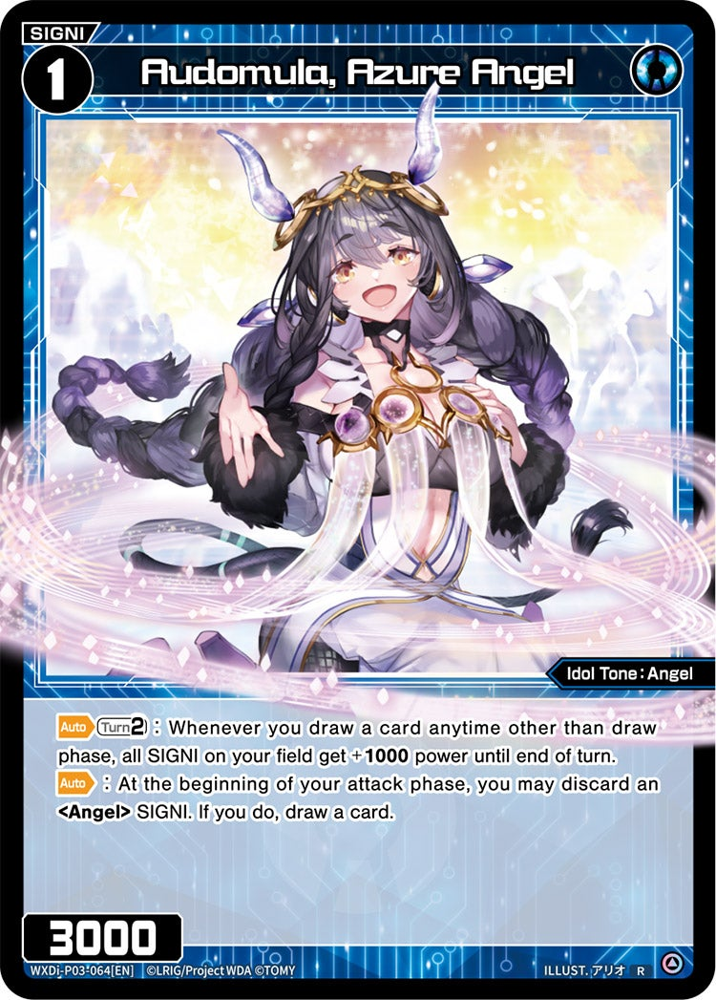

# Audomula, Azure Angel

## Thông tin lá

| Trường | Giá trị |
| --- | --- |
| Mã in | WXDi-P03-064[EN] |
| Set | WXDi-P03[EN] |
| Số thứ tự | 064 |
| Loại thẻ | SIGNI |
| Vị trí | Main Deck |
| Số bản | — (set booster, không áp dụng) |
| Màu | Xanh dương |
| Độ hiếm | R,R(P) |
| Minh họa | アリオ |
| Level | 1 |
| Limit | — |
| Power | 3000 |
| LRIG type / Class | Idol Tone：Angel |
| Team / Master | — |
| Cost | — |
| Grow cost | — |
| Use timing | — |
| Life Burst | Không |

## Card text chính thức

[Auto] {2/Turn}: Whenever you draw a card anytime other than draw phase, all SIGNI on your field get +1000 power until end of turn.
[Auto]: At the beginning of your attack phase, you may discard an <Angel> SIGNI. If you do, draw a card.

## Power text / Life Burst

—

## Ghi chú minh họa
Artist: アリオ. Ảnh R được tải từ Card List tiếng Anh.

## FAQ chính thức

**Q. If I draw a card with the below [Auto] ability, does it also trigger the above [Auto] ability?**
A. Yes, it is triggered.

## Ảnh biến thể

- [R(P)](../images/WXDi-P03-064P-EN.jpg)

## Nguồn
[Card List/FAQ chính thức](https://www.takaratomy.co.jp/products/en.wixoss/card/card.html?card_no=WXDi-P03-064%5BEN%5D ) · [Ảnh thẻ](https://www.takaratomy.co.jp/products/en.wixoss/card/thumb/WXDi-P03-064%5BEN%5D.jpg)
