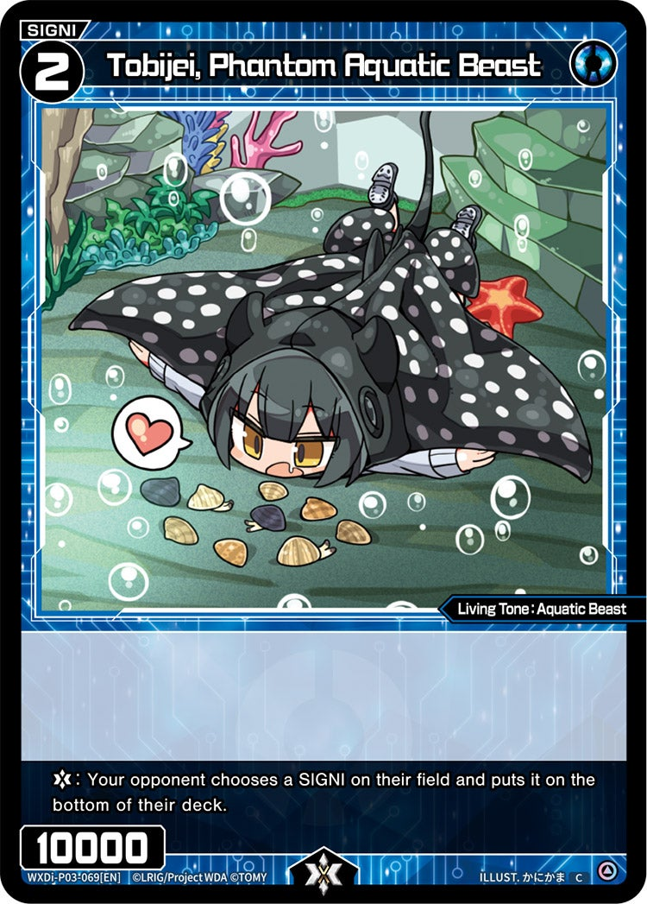

# Tobijei, Phantom Aquatic Beast

## Thông tin lá

| Trường | Giá trị |
| --- | --- |
| Mã in | WXDi-P03-069[EN] |
| Set | WXDi-P03[EN] |
| Số thứ tự | 069 |
| Loại thẻ | SIGNI |
| Vị trí | Main Deck |
| Số bản | — (set booster, không áp dụng) |
| Màu | Xanh dương |
| Độ hiếm | C,C(P) |
| Minh họa | かにかま |
| Level | 2 |
| Limit | — |
| Power | 10000 |
| LRIG type / Class | Living Tone：Aquatic Beast |
| Team / Master | — |
| Cost | — |
| Grow cost | — |
| Use timing | — |
| Life Burst | Có |

## Card text chính thức

—

## Power text / Life Burst

Your opponent chooses a SIGNI on their field and puts it on the bottom of their deck.

## Ghi chú minh họa
Artist: かにかま. Ảnh C được tải từ Card List tiếng Anh.

## FAQ chính thức

**Q. What happens if the only SIGNI on the opponent's field is a SIGNI with [Shadow] when I activate this SIGNI's Life Burst?**
A. This Life Burst is not a target selection effect, so the SIGNI with [Shadow] is selected and put at the bottom of the deck.

## Ảnh biến thể

- [C(P)](../images/WXDi-P03-069P-EN.jpg)

## Nguồn
[Card List/FAQ chính thức](https://www.takaratomy.co.jp/products/en.wixoss/card/card.html?card_no=WXDi-P03-069%5BEN%5D ) · [Ảnh thẻ](https://www.takaratomy.co.jp/products/en.wixoss/card/thumb/WXDi-P03-069%5BEN%5D.jpg)
