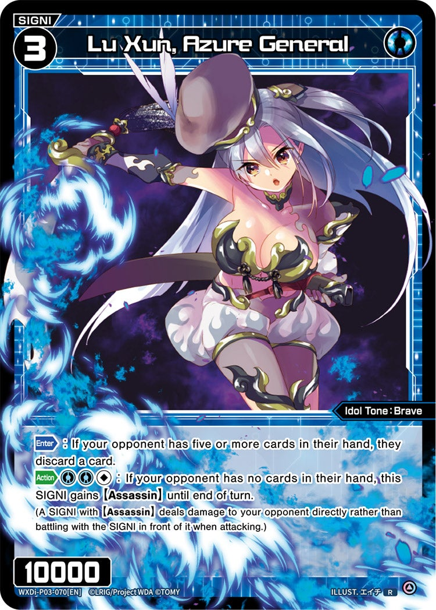

# Lu Xun, Azure General

## Thông tin lá

| Trường | Giá trị |
| --- | --- |
| Mã in | WXDi-P03-070[EN] |
| Set | WXDi-P03[EN] |
| Số thứ tự | 070 |
| Loại thẻ | SIGNI |
| Vị trí | Main Deck |
| Số bản | — (set booster, không áp dụng) |
| Màu | Xanh dương |
| Độ hiếm | R,R(P) |
| Minh họa | エイチ |
| Level | 3 |
| Limit | — |
| Power | 10000 |
| LRIG type / Class | Idol Tone：Brave |
| Team / Master | — |
| Cost | — |
| Grow cost | — |
| Use timing | — |
| Life Burst | Không |

## Card text chính thức

[Enter]: If your opponent has five or more cards in their hand, they discard a card.
[Action] {Blue} {Blue} {Colorless}: If your opponent has no cards in their hand, this SIGNI gains 【Assassin】 until end of turn.
(A SIGNI with 【Assassin】 deals damage to your opponent directly rather than battling with the SIGNI in front of it when attacking.)

## Power text / Life Burst

—

## Ghi chú minh họa
Artist: エイチ. Ảnh R được tải từ Card List tiếng Anh.

## FAQ chính thức

**Q. I used [Action] ability and this SIGNI gained [Assassin], but then my opponent activated a card draw effect and I now have more than 1 card in my hand. What happens to the [Assassin] that it gained?**
A. The number of cards in the opponent's hand is checked by [Action] ability only when [Action] ability is activated, so even if the number of cards in the hand changes later, the player still gains [Assassin] this turn.

## Ảnh biến thể

- [R(P)](../images/WXDi-P03-070P-EN.jpg)

## Nguồn
[Card List/FAQ chính thức](https://www.takaratomy.co.jp/products/en.wixoss/card/card.html?card_no=WXDi-P03-070%5BEN%5D ) · [Ảnh thẻ](https://www.takaratomy.co.jp/products/en.wixoss/card/thumb/WXDi-P03-070%5BEN%5D.jpg)
