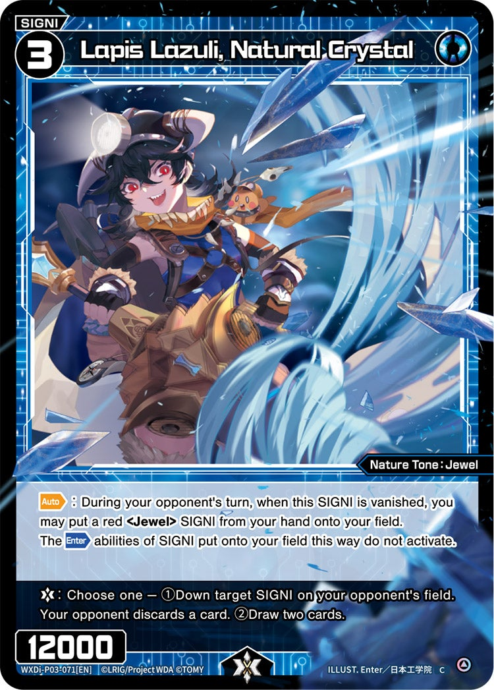

# Lapis Lazuli, Natural Crystal

## Thông tin lá

| Trường | Giá trị |
| --- | --- |
| Mã in | WXDi-P03-071[EN] |
| Set | WXDi-P03[EN] |
| Số thứ tự | 071 |
| Loại thẻ | SIGNI |
| Vị trí | Main Deck |
| Số bản | — (set booster, không áp dụng) |
| Màu | Xanh dương |
| Độ hiếm | C,C(P) |
| Minh họa | Enter／日本工学院 |
| Level | 3 |
| Limit | — |
| Power | 12000 |
| LRIG type / Class | Nature Tone：Jewel |
| Team / Master | — |
| Cost | — |
| Grow cost | — |
| Use timing | — |
| Life Burst | Có |

## Card text chính thức

[Auto]: During your opponent's turn, when this SIGNI is vanished, you may put a red <Jewel> SIGNI from your hand onto your field. The [Enter] abilities of SIGNI put onto your field this way do not activate.

## Power text / Life Burst

Choose one — ①Down target SIGNI on your opponent's field. Your opponent discards a card. ②Draw two cards.

## Ghi chú minh họa
Artist: Enter／日本工学院. Ảnh C được tải từ Card List tiếng Anh.

## FAQ chính thức

— (không có FAQ riêng cho mã này trên trang FAQ tiếng Anh.)

## Ảnh biến thể

- [C(P)](../images/WXDi-P03-071P-EN.jpg)

## Nguồn
[Card List/FAQ chính thức](https://www.takaratomy.co.jp/products/en.wixoss/card/card.html?card_no=WXDi-P03-071%5BEN%5D ) · [Ảnh thẻ](https://www.takaratomy.co.jp/products/en.wixoss/card/thumb/WXDi-P03-071%5BEN%5D.jpg)
