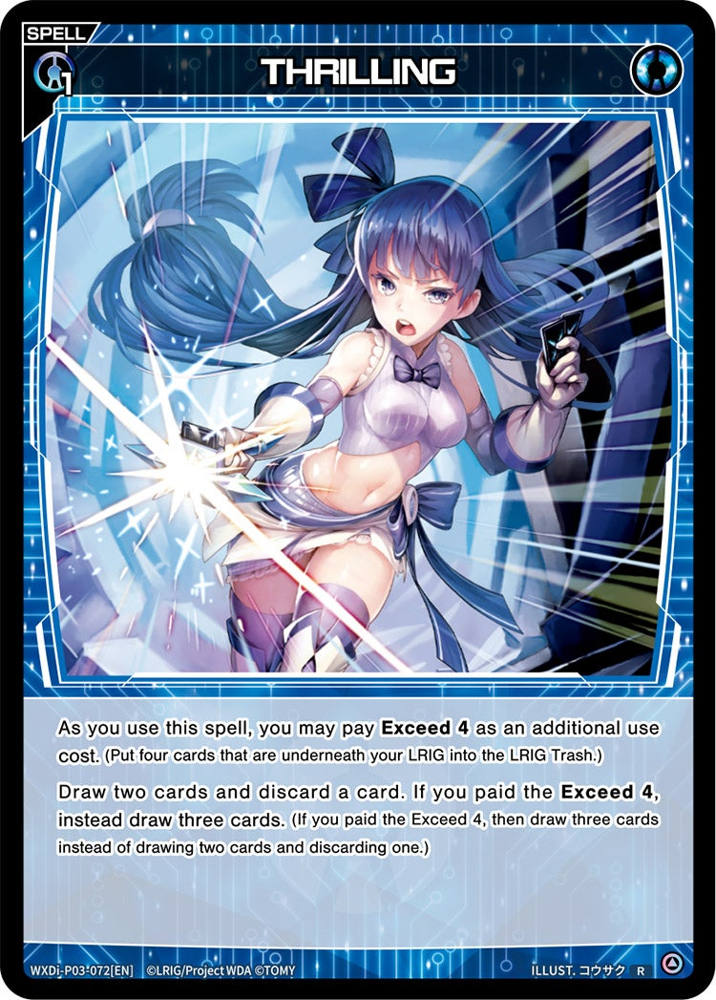

# THRILLING

## Thông tin lá

| Trường | Giá trị |
| --- | --- |
| Mã in | WXDi-P03-072[EN] |
| Set | WXDi-P03[EN] |
| Số thứ tự | 072 |
| Loại thẻ | SPELL |
| Vị trí | Main Deck |
| Số bản | — (set booster, không áp dụng) |
| Màu | Xanh dương |
| Độ hiếm | R,R(P) |
| Minh họa | コウサク |
| Level | — |
| Limit | — |
| Power | 0 |
| LRIG type / Class | — |
| Team / Master | — |
| Cost | 《U》×１ |
| Grow cost | — |
| Use timing | — |
| Life Burst | Không |

## Card text chính thức

As you use this spell, you may pay Exceed 4 as an additional use cost. (Put four cards that are underneath your LRIG into the LRIG Trash.)

Draw two cards and discard a card. If you paid the Exceed 4, instead draw three cards. (If you paid the Exceed 4, then draw three cards instead of drawing two cards and discarding one.)

## Power text / Life Burst

—

## Ghi chú minh họa
Artist: コウサク. Ảnh R được tải từ Card List tiếng Anh.

## FAQ chính thức

— (không có FAQ riêng cho mã này trên trang FAQ tiếng Anh.)

## Ảnh biến thể

- [R(P)](../images/WXDi-P03-072P-EN.jpg)

## Nguồn
[Card List/FAQ chính thức](https://www.takaratomy.co.jp/products/en.wixoss/card/card.html?card_no=WXDi-P03-072%5BEN%5D ) · [Ảnh thẻ](https://www.takaratomy.co.jp/products/en.wixoss/card/thumb/WXDi-P03-072%5BEN%5D.jpg)
