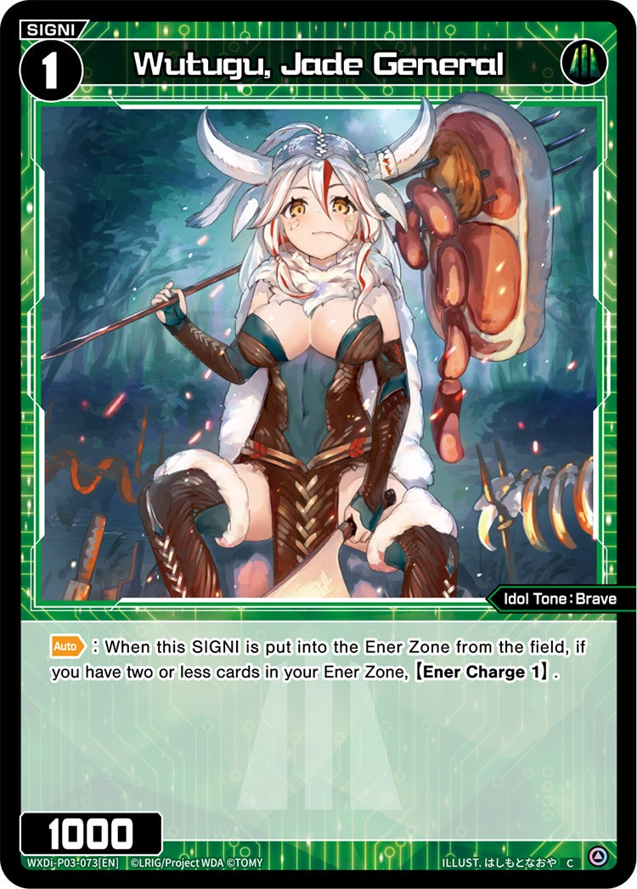

# Wutugu, Jade General

## Thông tin lá

| Trường | Giá trị |
| --- | --- |
| Mã in | WXDi-P03-073[EN] |
| Set | WXDi-P03[EN] |
| Số thứ tự | 073 |
| Loại thẻ | SIGNI |
| Vị trí | Main Deck |
| Số bản | — (set booster, không áp dụng) |
| Màu | Xanh lá |
| Độ hiếm | C,C(P) |
| Minh họa | はしもとなおや |
| Level | 1 |
| Limit | — |
| Power | 1000 |
| LRIG type / Class | Idol Tone：Brave |
| Team / Master | — |
| Cost | — |
| Grow cost | — |
| Use timing | — |
| Life Burst | Không |

## Card text chính thức

[Auto]: When this SIGNI is put into the Ener Zone from the field, if you have two or less cards in your Ener Zone, 【Ener Charge 1】.

## Power text / Life Burst

—

## Ghi chú minh họa
Artist: はしもとなおや. Ảnh C được tải từ Card List tiếng Anh.

## FAQ chính thức

**Q. When this SIGNI is varnished, is [Auto] ability tirggered?**
A. Yes, [Auto] ability is also triggered when the card is vanished and put into the Ener Zone.

## Ảnh biến thể

- [C(P)](../images/WXDi-P03-073P-EN.jpg)

## Nguồn
[Card List/FAQ chính thức](https://www.takaratomy.co.jp/products/en.wixoss/card/card.html?card_no=WXDi-P03-073%5BEN%5D ) · [Ảnh thẻ](https://www.takaratomy.co.jp/products/en.wixoss/card/thumb/WXDi-P03-073%5BEN%5D.jpg)
