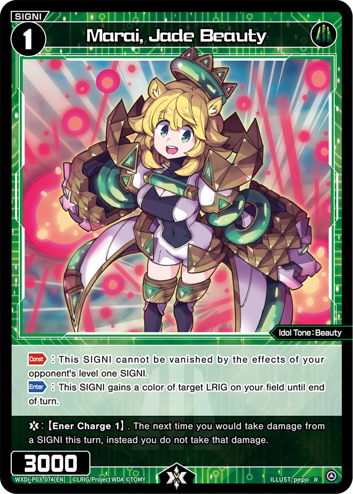

# Marai, Jade Beauty

## Thông tin lá

| Trường | Giá trị |
| --- | --- |
| Mã in | WXDi-P03-074[EN] |
| Set | WXDi-P03[EN] |
| Số thứ tự | 074 |
| Loại thẻ | SIGNI |
| Vị trí | Main Deck |
| Số bản | — (set booster, không áp dụng) |
| Màu | Xanh lá |
| Độ hiếm | R,R(P) |
| Minh họa | pepo |
| Level | 1 |
| Limit | — |
| Power | 3000 |
| LRIG type / Class | Idol Tone：Beauty |
| Team / Master | — |
| Cost | — |
| Grow cost | — |
| Use timing | — |
| Life Burst | Có |

## Card text chính thức

[Constant]: This SIGNI cannot be vanished by the effects of your opponent's level one SIGNI.
[Enter]: This SIGNI gains a color of target LRIG on your field until end of turn.

## Power text / Life Burst

【Ener Charge 1】. The next time you would take damage from a SIGNI this turn, instead you do not take that damage.

## Ghi chú minh họa
Artist: pepo. Ảnh R được tải từ Card List tiếng Anh.

## FAQ chính thức

**Q. If the power of this SIGNI gets -3000 by the effect of my opponent's level 1 SIGNI, is this SIGNI vanished?**
A. Yes, it will be vanished. Even though the effect that minus power is due to level 1 SIGNI, the vanish due to power being reduced to 0 is due to the rules, so it is vanished by the rules process.

**Q. If I choose a black LRIG with [Enter] ability, what will be the color of this SIGNI?**
A. The original color, green, will remain, so it will be green and black SIGNI.

## Ảnh biến thể

- [R(P)](../images/WXDi-P03-074P-EN.jpg)

## Nguồn
[Card List/FAQ chính thức](https://www.takaratomy.co.jp/products/en.wixoss/card/card.html?card_no=WXDi-P03-074%5BEN%5D ) · [Ảnh thẻ](https://www.takaratomy.co.jp/products/en.wixoss/card/thumb/WXDi-P03-074%5BEN%5D.jpg)
