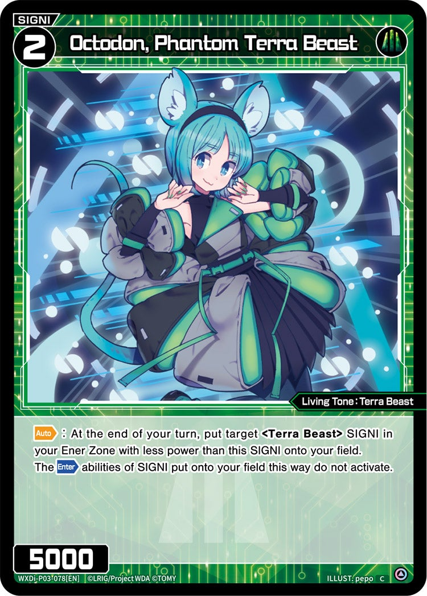

# Octodon, Phantom Terra Beast

## Thông tin lá

| Trường | Giá trị |
| --- | --- |
| Mã in | WXDi-P03-078[EN] |
| Set | WXDi-P03[EN] |
| Số thứ tự | 078 |
| Loại thẻ | SIGNI |
| Vị trí | Main Deck |
| Số bản | — (set booster, không áp dụng) |
| Màu | Xanh lá |
| Độ hiếm | C,C(P) |
| Minh họa | pepo |
| Level | 2 |
| Limit | — |
| Power | 5000 |
| LRIG type / Class | Living Tone：Terra Beast |
| Team / Master | — |
| Cost | — |
| Grow cost | — |
| Use timing | — |
| Life Burst | Không |

## Card text chính thức

[Auto]: At the end of your turn, put target <Terra Beast> SIGNI in your Ener Zone with less power than this SIGNI onto your field. The [Enter] abilities of SIGNI put onto your field this way do not activate.

## Power text / Life Burst

—

## Ghi chú minh họa
Artist: pepo. Ảnh C được tải từ Card List tiếng Anh.

## FAQ chính thức

**Q. Is it possible to not use the [Auto] ability?**
A. Yes, Auto ability that meets the conditions is compulsorily activated, so if there is a SIGNI that can be targeted, one of them must be targeted and put onto the field. However, if bringing out the chosen SIGNI exceeds the level or limit of the LRIG, the SIGNI will not be brought out and will remain on the Ener Zone, and the effect will end.

**Q. If the power of this SIGNI is added until the end of the turn by the effect of "Orangutan, Phantom Terra Beast", what happens to the [Auto] ability?**
A. The End phase, in turn,processes the ability that triggers "at the end of turn", and discards cards so that you have 6 cards in your hand, and the "until the end of turn" effect disappears.
 Since this [Auto] ability is triggered before the effect that adds power until end of turn disappears, you can put a lower <Terra Beast> SIGNI ontto the field referring to the added power.

## Ảnh biến thể

- [C(P)](../images/WXDi-P03-078P-EN.jpg)

## Nguồn
[Card List/FAQ chính thức](https://www.takaratomy.co.jp/products/en.wixoss/card/card.html?card_no=WXDi-P03-078%5BEN%5D ) · [Ảnh thẻ](https://www.takaratomy.co.jp/products/en.wixoss/card/thumb/WXDi-P03-078%5BEN%5D.jpg)
