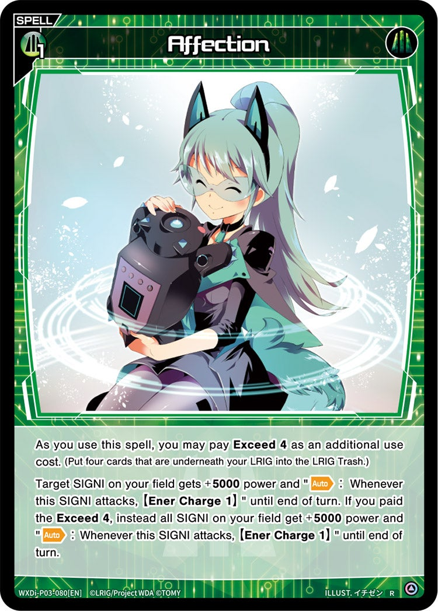

# Affection

## Thông tin lá

| Trường | Giá trị |
| --- | --- |
| Mã in | WXDi-P03-080[EN] |
| Set | WXDi-P03[EN] |
| Số thứ tự | 080 |
| Loại thẻ | SPELL |
| Vị trí | Main Deck |
| Số bản | — (set booster, không áp dụng) |
| Màu | Xanh lá |
| Độ hiếm | R,R(P) |
| Minh họa | イチゼン |
| Level | — |
| Limit | — |
| Power | 0 |
| LRIG type / Class | — |
| Team / Master | — |
| Cost | 《G》×１ |
| Grow cost | — |
| Use timing | — |
| Life Burst | Không |

## Card text chính thức

As you use this spell, you may pay Exceed 4 as an additional use cost. (Put four cards that are underneath your LRIG into the LRIG Trash.)

Target SIGNI on your field gets +5000 power and "[Auto]: Whenever this SIGNI attacks, 【Ener Charge 1】" until end of turn. If you paid the Exceed 4, instead all SIGNI on your field get +5000 power and "[Auto]: Whenever this SIGNI attacks, 【Ener Charge 1】" until end of turn.

## Power text / Life Burst

—

## Ghi chú minh họa
Artist: イチゼン. Ảnh R được tải từ Card List tiếng Anh.

## FAQ chính thức

**Q. I used two copies of this spell on the same SIGNI. What happens when that SIGNI attacks?**
A. With this card's ability triggered, you perform Refresh, as the rule process, first.
[Auto] ability is triggered after Refresh, but this card is not in Trash, so you cannot add this card to your hand even if you discard your hand.

## Ảnh biến thể

- [R(P)](../images/WXDi-P03-080P-EN.jpg)

## Nguồn
[Card List/FAQ chính thức](https://www.takaratomy.co.jp/products/en.wixoss/card/card.html?card_no=WXDi-P03-080%5BEN%5D ) · [Ảnh thẻ](https://www.takaratomy.co.jp/products/en.wixoss/card/thumb/WXDi-P03-080%5BEN%5D.jpg)
