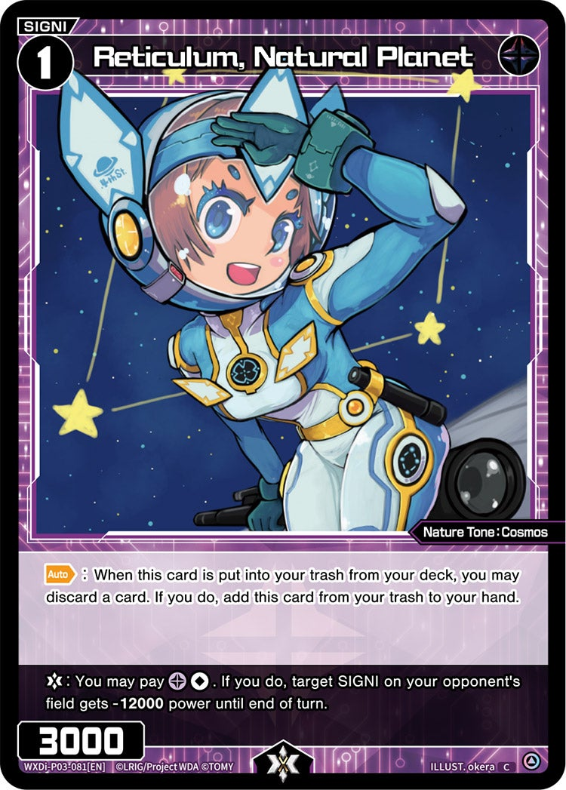

# Reticulum, Natural Planet

## Thông tin lá

| Trường | Giá trị |
| --- | --- |
| Mã in | WXDi-P03-081[EN] |
| Set | WXDi-P03[EN] |
| Số thứ tự | 081 |
| Loại thẻ | SIGNI |
| Vị trí | Main Deck |
| Số bản | — (set booster, không áp dụng) |
| Màu | Đen |
| Độ hiếm | C,C(P) |
| Minh họa | okera |
| Level | 1 |
| Limit | — |
| Power | 3000 |
| LRIG type / Class | Nature Tone：Cosmos |
| Team / Master | — |
| Cost | — |
| Grow cost | — |
| Use timing | — |
| Life Burst | Có |

## Card text chính thức

[Auto]: When this card is put into your trash from your deck, you may discard a card. If you do, add this card from your trash to your hand.

## Power text / Life Burst

You may pay {Black} {Colorless}. If you do, target SIGNI on your opponent's field gets -12000 power until end of turn.

## Ghi chú minh họa
Artist: okera. Ảnh C được tải từ Card List tiếng Anh.

## FAQ chính thức

**Q. I activated an effect to put the top 3 cards of the deck into the Trash, and this card was put into the Trash, but at the same time the deck became 0 cards. What happens now?**
A. With this card's ability triggered, you perform Refresh, as the rule process, first.
[Auto] ability is triggered after Refresh, but this card is not in Trash, so you cannot add this card to your hand even if you discard your hand.

## Ảnh biến thể

- [C(P)](../images/WXDi-P03-081P-EN.jpg)

## Nguồn
[Card List/FAQ chính thức](https://www.takaratomy.co.jp/products/en.wixoss/card/card.html?card_no=WXDi-P03-081%5BEN%5D ) · [Ảnh thẻ](https://www.takaratomy.co.jp/products/en.wixoss/card/thumb/WXDi-P03-081%5BEN%5D.jpg)
