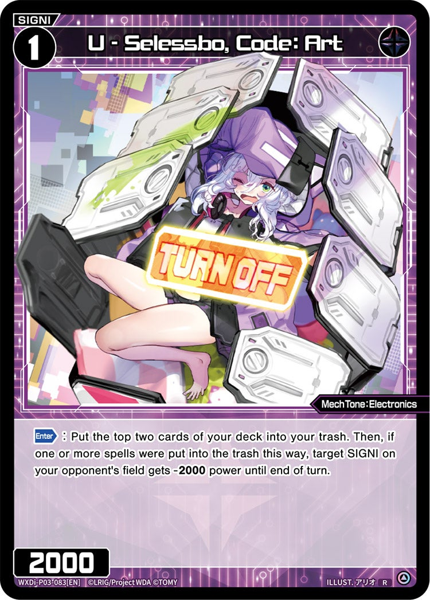

# U-Selessbo, Code: Art

## Thông tin lá

| Trường | Giá trị |
| --- | --- |
| Mã in | WXDi-P03-083[EN] |
| Set | WXDi-P03[EN] |
| Số thứ tự | 083 |
| Loại thẻ | SIGNI |
| Vị trí | Main Deck |
| Số bản | — (set booster, không áp dụng) |
| Màu | Đen |
| Độ hiếm | R,R(P) |
| Minh họa | アリオ |
| Level | 1 |
| Limit | — |
| Power | 2000 |
| LRIG type / Class | Mech Tone：Electronics |
| Team / Master | — |
| Cost | — |
| Grow cost | — |
| Use timing | — |
| Life Burst | Không |

## Card text chính thức

[Enter]: Put the top two cards of your deck into your trash. Then, if one or more spells were put into the trash this way, target SIGNI on your opponent's field gets -2000 power until end of turn.

## Power text / Life Burst

—

## Ghi chú minh họa
Artist: アリオ. Ảnh R được tải từ Card List tiếng Anh.

## FAQ chính thức

**Q. If two spells are put into your Trash with [Enter] ability, can target opponent's SIGNI gets -4000?**
A. No. Even if one or two spells are placed, the power modifier to the opponent's SIGNI is only -2000.

## Ảnh biến thể

- [R(P)](../images/WXDi-P03-083P-EN.jpg)

## Nguồn
[Card List/FAQ chính thức](https://www.takaratomy.co.jp/products/en.wixoss/card/card.html?card_no=WXDi-P03-083%5BEN%5D ) · [Ảnh thẻ](https://www.takaratomy.co.jp/products/en.wixoss/card/thumb/WXDi-P03-083%5BEN%5D.jpg)
