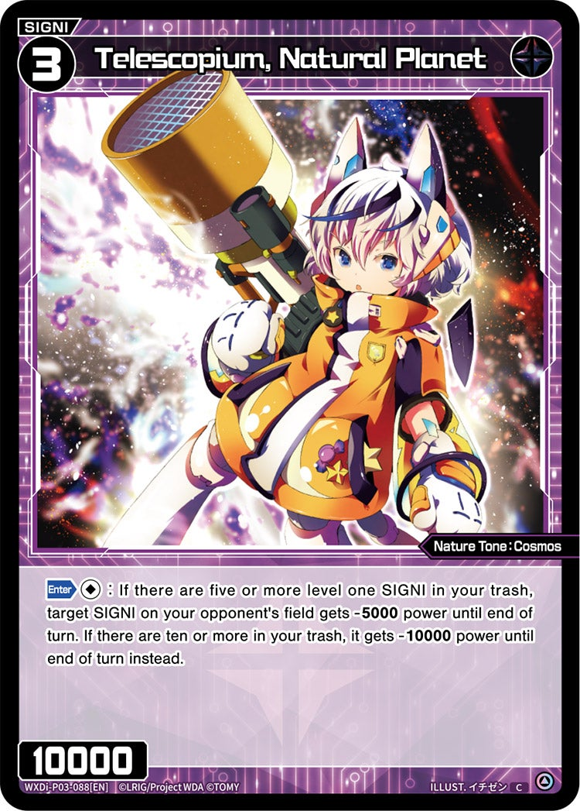

# Telescopium, Natural Planet

## Thông tin lá

| Trường | Giá trị |
| --- | --- |
| Mã in | WXDi-P03-088[EN] |
| Set | WXDi-P03[EN] |
| Số thứ tự | 088 |
| Loại thẻ | SIGNI |
| Vị trí | Main Deck |
| Số bản | — (set booster, không áp dụng) |
| Màu | Đen |
| Độ hiếm | C,C(P) |
| Minh họa | イチゼン |
| Level | 3 |
| Limit | — |
| Power | 10000 |
| LRIG type / Class | Nature Tone：Cosmos |
| Team / Master | — |
| Cost | — |
| Grow cost | — |
| Use timing | — |
| Life Burst | Không |

## Card text chính thức

[Enter] {Colorless}: If there are five or more level one SIGNI in your trash, target SIGNI on your opponent's field gets -5000 power until end of turn. If there are ten or more in your trash, it gets -10000 power until end of turn instead.

## Power text / Life Burst

—

## Ghi chú minh họa
Artist: イチゼン. Ảnh C được tải từ Card List tiếng Anh.

## FAQ chính thức

**Q. When counting level 1 SIGNI in Trash, do we include cards paid for as [Enter] ability costs?**
A. Yes, they are included and counted.

## Ảnh biến thể

- [C(P)](../images/WXDi-P03-088P-EN.jpg)

## Nguồn
[Card List/FAQ chính thức](https://www.takaratomy.co.jp/products/en.wixoss/card/card.html?card_no=WXDi-P03-088%5BEN%5D ) · [Ảnh thẻ](https://www.takaratomy.co.jp/products/en.wixoss/card/thumb/WXDi-P03-088%5BEN%5D.jpg)
