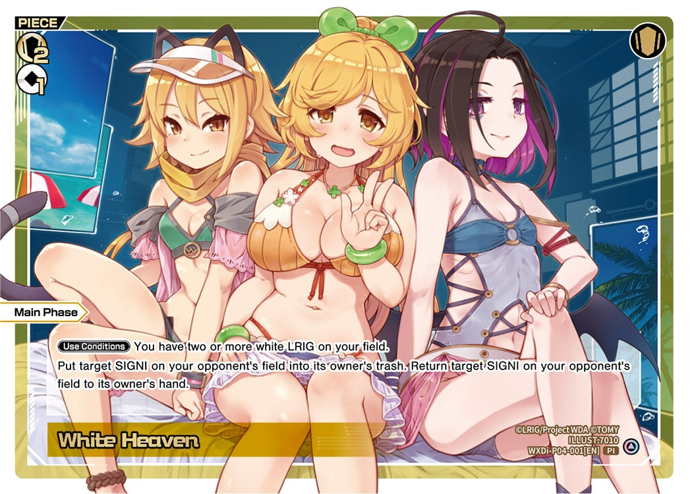

# White Heaven

## Thông tin lá

| Trường | Giá trị |
| --- | --- |
| Mã in | WXDi-P04-001[EN] |
| Set | WXDi-P04[EN] |
| Số thứ tự | 001 |
| Loại thẻ | PIECE |
| Vị trí | LRIG Deck |
| Số bản | — (set booster, không áp dụng) |
| Màu | Trắng |
| Độ hiếm | PI |
| Minh họa | 7010 |
| Level | — |
| Limit | — |
| Power | 0 |
| LRIG type / Class | — |
| Team / Master | — |
| Cost | 《W》×２
《C》×１ |
| Grow cost | — |
| Use timing | Main Phase |
| Life Burst | Không |

## Card text chính thức

[Use Conditions] You have two or more white LRIG on your field.

Put target SIGNI on your opponent's field into its owner's trash. Return target SIGNI on your opponent's field to its owner's hand.

## Power text / Life Burst

—

## Ghi chú minh họa
Artist: 7010. Ảnh PI được tải từ Card List tiếng Anh.

## FAQ chính thức

**Q. When there is only one SIGNI on my opponent's field, if I play this PEACE, what happens?**
A. Both effects target one SIGNI, but the effects are processed in order from the top of text, so put target SIGNI into its owner's trash first. That SIGNI will never return to its owner's hand.

## Nguồn
[Card List/FAQ chính thức](https://www.takaratomy.co.jp/products/en.wixoss/card/card.html?card_no=WXDi-P04-001%5BEN%5D ) · [Ảnh thẻ](https://www.takaratomy.co.jp/products/en.wixoss/card/thumb/WXDi-P04-001%5BEN%5D.jpg)
