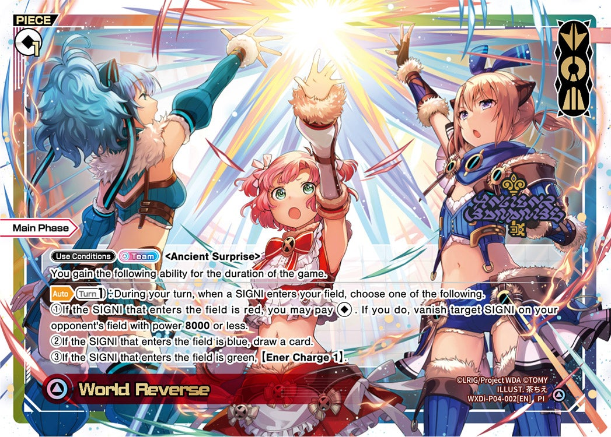

# World Reverse

## Thông tin lá

| Trường | Giá trị |
| --- | --- |
| Mã in | WXDi-P04-002[EN] |
| Set | WXDi-P04[EN] |
| Số thứ tự | 002 |
| Loại thẻ | PIECE |
| Vị trí | LRIG Deck |
| Số bản | — (set booster, không áp dụng) |
| Màu | Đỏ / xanh dương / xanh lá |
| Độ hiếm | PI |
| Minh họa | 茶ちえ |
| Level | — |
| Limit | — |
| Power | 0 |
| LRIG type / Class | — |
| Team / Master | — |
| Cost | 《C》×１ |
| Grow cost | — |
| Use timing | Main Phase |
| Life Burst | Không |

## Card text chính thức

[Use Conditions] [Team] <Ancient Surprise>

You gain the following ability for the duration of the game.
『[Auto] {1/Turn}: During your turn, when a SIGNI enters your field, choose one of the following.
①If the SIGNI that enters the field is red, you may pay {Colorless}. If you do, vanish target SIGNI on your opponent's field with power 8000 or less.
②If the SIGNI that enters the field is blue, draw a card.
③If the SIGNI that enters the field is green, 【Ener Charge 1】.』

## Power text / Life Burst

—

## Ghi chú minh họa
Artist: 茶ちえ. Ảnh PI được tải từ Card List tiếng Anh.

## FAQ chính thức

**Q. During my turn, I put "Servant ♯" onto my field after I played this PEACE. May I choose not to trigger this PEACE's [Auto] ability?**
A. No, you cannot. [Auto] abilities are automatically triggered if the conditions are met. The condition of this [Auto] ability is "During your turn, when a SIGNI enters your field", so it will must be triggered even if the SIGNI enters your field is a SIGNI that is not red, blue or green.

**Q. If I put "Bronze, Natural Crystal" which is red and blue, may I choose both the effect of ① and ②?**
A. No, you cannot. You may only choose one from three. You may choose either ① or ② to resolve the effect, or you can choose ③, which does nothing happen as a result.

## Nguồn
[Card List/FAQ chính thức](https://www.takaratomy.co.jp/products/en.wixoss/card/card.html?card_no=WXDi-P04-002%5BEN%5D ) · [Ảnh thẻ](https://www.takaratomy.co.jp/products/en.wixoss/card/thumb/WXDi-P04-002%5BEN%5D.jpg)
