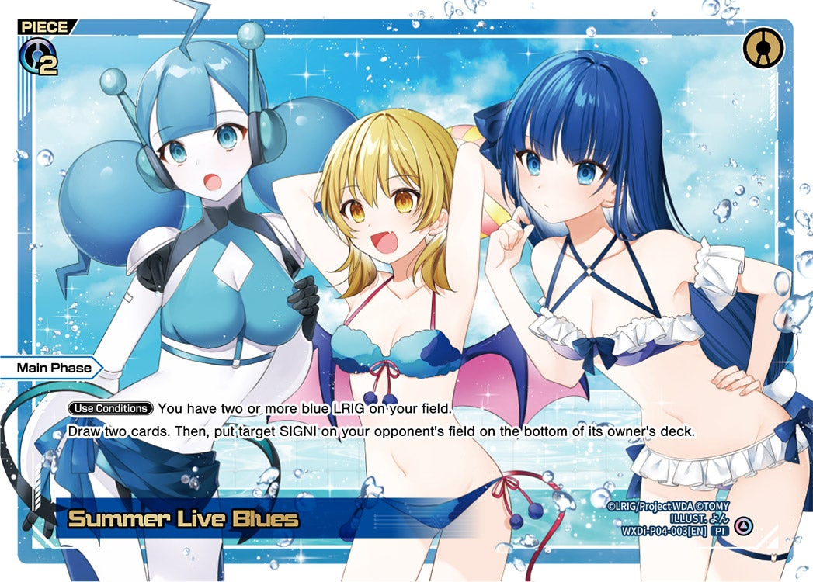

# Summer Live Blues

## Thông tin lá

| Trường | Giá trị |
| --- | --- |
| Mã in | WXDi-P04-003[EN] |
| Set | WXDi-P04[EN] |
| Số thứ tự | 003 |
| Loại thẻ | PIECE |
| Vị trí | LRIG Deck |
| Số bản | — (set booster, không áp dụng) |
| Màu | Xanh dương |
| Độ hiếm | PI |
| Minh họa | よん |
| Level | — |
| Limit | — |
| Power | 0 |
| LRIG type / Class | — |
| Team / Master | — |
| Cost | 《U》×２ |
| Grow cost | — |
| Use timing | Main Phase |
| Life Burst | Không |

## Card text chính thức

[Use Conditions] You have two or more blue LRIG on your field.

Draw two cards. Then, put target SIGNI on your opponent's field on the bottom of its owner's deck.

## Power text / Life Burst

—

## Ghi chú minh họa
Artist: よん. Ảnh PI được tải từ Card List tiếng Anh.

## FAQ chính thức

**Q. If there are no SIGNI on my opponent's field, may I play this PEACE?**
A. Yes, you can. In that case, you only draw two cards.

**Q. I played this PEACE when there are 2 cards or less than left in my deck. "put target SIGNI on your opponent's field on the bottom of its owner's deck" and refresh my deck, which one will be processed first?**
A. You process "put target SIGNI on your opponent's field on the bottom of its owner's deck" first. If the main deck becomes 0 during the processing of an effect, let the effect be processed as much as possible while the main deck remains 0, and then Rule-based action such as refresh. So you resolve effect of PEACE as much as possible first.

## Nguồn
[Card List/FAQ chính thức](https://www.takaratomy.co.jp/products/en.wixoss/card/card.html?card_no=WXDi-P04-003%5BEN%5D ) · [Ảnh thẻ](https://www.takaratomy.co.jp/products/en.wixoss/card/thumb/WXDi-P04-003%5BEN%5D.jpg)
