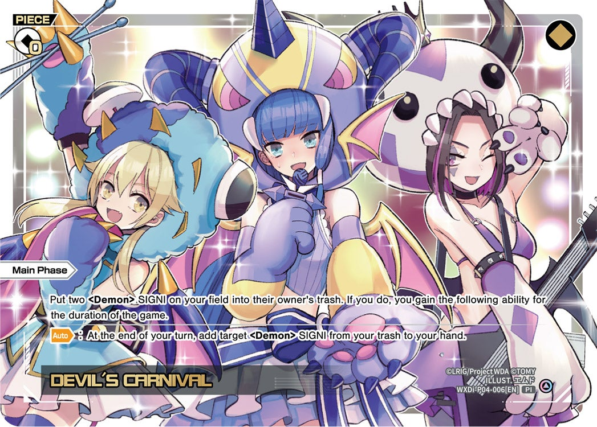

# DEVIL'S CARNIVAL

## Thông tin lá

| Trường | Giá trị |
| --- | --- |
| Mã in | WXDi-P04-006[EN] |
| Set | WXDi-P04[EN] |
| Số thứ tự | 006 |
| Loại thẻ | PIECE |
| Vị trí | LRIG Deck |
| Số bản | — (set booster, không áp dụng) |
| Màu | Không màu |
| Độ hiếm | PI |
| Minh họa | エムド |
| Level | — |
| Limit | — |
| Power | 0 |
| LRIG type / Class | — |
| Team / Master | — |
| Cost | 《C》×０ |
| Grow cost | — |
| Use timing | Main Phase |
| Life Burst | Không |

## Card text chính thức

Put two <Demon> SIGNI on your field into their owner's trash. If you do, you gain the following ability for the duration of the game.
『[Auto]: At the end of your turn, add target <Demon> SIGNI from your trash to your hand.』

## Power text / Life Burst

—

## Ghi chú minh họa
Artist: エムド. Ảnh PI được tải từ Card List tiếng Anh.

## FAQ chính thức

**Q. There are "Anna Mirage, Doomed Evil", and a <Demon> SIGNI palced underneath by 【Rise】 of "Anna Mirage, Doomed Evil" on your field. When I want to play this PEACE, may I put them into my trash and gain the PEACE's ability?**
A. No, you cannot play. The effect of "Put two <Demon> SIGNI on your field into their owner's trash" can only move the SIGNI that is on the field as a SIGNI, and you cannot chose the card placed underneath or a card attached to it. In this case, you may put "Anna Mirage, Doomed Evil" into your trash, but you need put another <Demon> SIGNI that is on your field as a SIGNI into your trash.

## Nguồn
[Card List/FAQ chính thức](https://www.takaratomy.co.jp/products/en.wixoss/card/card.html?card_no=WXDi-P04-006%5BEN%5D ) · [Ảnh thẻ](https://www.takaratomy.co.jp/products/en.wixoss/card/thumb/WXDi-P04-006%5BEN%5D.jpg)
