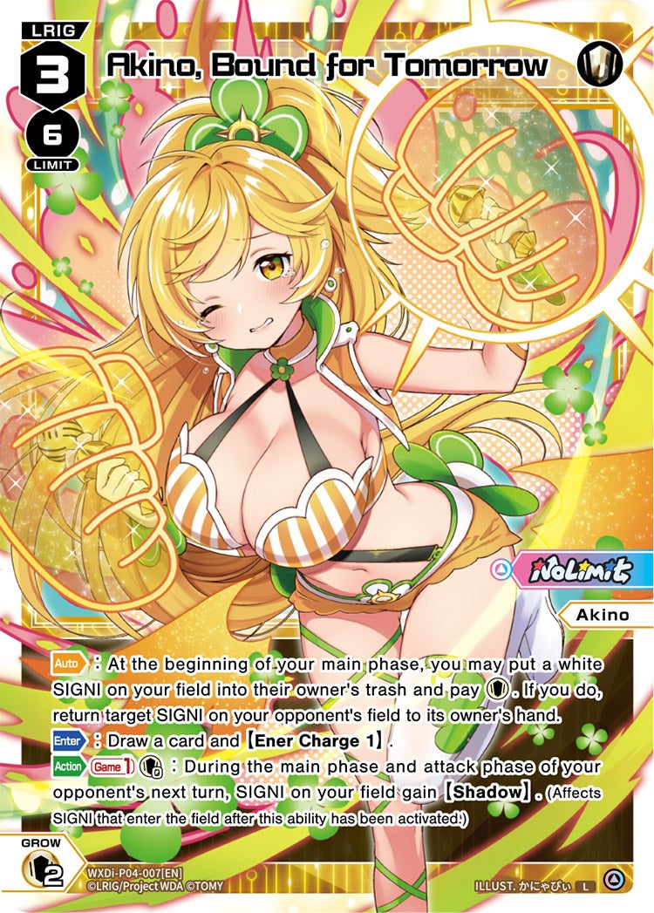

# Akino, Bound for Tomorrow

## Thông tin lá

| Trường | Giá trị |
| --- | --- |
| Mã in | WXDi-P04-007[EN] |
| Set | WXDi-P04[EN] |
| Số thứ tự | 007 |
| Loại thẻ | LRIG |
| Vị trí | LRIG Deck |
| Số bản | — (set booster, không áp dụng) |
| Màu | Trắng |
| Độ hiếm | L,SCR,DiR |
| Minh họa | かにゃぴぃ |
| Level | 3 |
| Limit | 6 |
| Power | 0 |
| LRIG type / Class | Akino |
| Team / Master | No Limit |
| Cost | — |
| Grow cost | 《W》×２ |
| Use timing | — |
| Life Burst | Không |

## Card text chính thức

[Auto]: At the beginning of your main phase, you may put a white SIGNI on your field into their owner's trash and pay {White}. If you do, return target SIGNI on your opponent's field to its owner's hand.
[Enter]: Draw a card and 【Ener Charge 1】.
[Action] {1/Game} {Whitex0}: During the main phase and attack phase of your opponent's next turn, SIGNI on your field gain 【Shadow】. (Affects SIGNI that enter the field after this ability has been activated.)

## Power text / Life Burst

—

## Ghi chú minh họa
Artist: かにゃぴぃ. Ảnh L được tải từ Card List tiếng Anh.

## FAQ chính thức

**Q. May I pay only the cost of either "put a white SIGNI on your field into their owner's trash" or "pay {White}" when [Auto] ability triggers?**
A. No, you cannot. Only if you may pay both costs, you may choose to pay both costs to play [Auto] ability or not.

## Ảnh biến thể

- [DiR](../images/WXDi-P04-007D-EN.jpg)
- [SCR](../images/WXDi-P04-007S-EN.jpg)

## Nguồn
[Card List/FAQ chính thức](https://www.takaratomy.co.jp/products/en.wixoss/card/card.html?card_no=WXDi-P04-007%5BEN%5D ) · [Ảnh thẻ](https://www.takaratomy.co.jp/products/en.wixoss/card/thumb/WXDi-P04-007%5BEN%5D.jpg)
