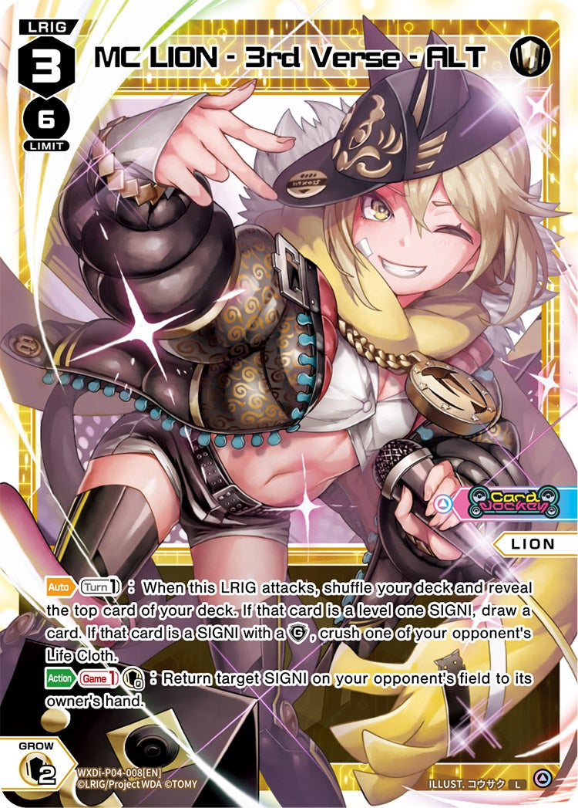

# MC LION - 3rd Verse - ALT

## Thông tin lá

| Trường | Giá trị |
| --- | --- |
| Mã in | WXDi-P04-008[EN] |
| Set | WXDi-P04[EN] |
| Số thứ tự | 008 |
| Loại thẻ | LRIG |
| Vị trí | LRIG Deck |
| Số bản | — (set booster, không áp dụng) |
| Màu | Trắng |
| Độ hiếm | L,SCR,DiR |
| Minh họa | コウサク |
| Level | 3 |
| Limit | 6 |
| Power | 0 |
| LRIG type / Class | LION |
| Team / Master | Card Jockey |
| Cost | — |
| Grow cost | 《W》×２ |
| Use timing | — |
| Life Burst | Không |

## Card text chính thức

[Auto] {1/Turn}: When this LRIG attacks, shuffle your deck and reveal the top card of your deck. If that card is a level one SIGNI, draw a card. If that card is a SIGNI with a {Guard Icon}, crush one of your opponent's Life Cloth.
[Action] {1/Game} {Whitex0}: Return target SIGNI on your opponent's field to its owner's hand.

## Power text / Life Burst

—

## Ghi chú minh họa
Artist: コウサク. Ảnh L được tải từ Card List tiếng Anh.

## FAQ chính thức

**Q. If the card revealed by [Auto] ability is a level one SIGNI, Do I draw the revealed level one SIGNI by that effect?**
A. Yes, you draw a revealed level one SIGNI and put into you hand.

**Q. If the card revealed by [Auto] ability is a level one "Servant ♯" SIGNI with a {Guard Icon}, what will happen?**
A. In that case, the effects of "draw a card" and "crush one of your opponent's Life Cloth" are processed. So you draw a card, then crush one of your opponent's Life Cloth.

## Ảnh biến thể

- [DiR](../images/WXDi-P04-008D-EN.jpg)
- [SCR](../images/WXDi-P04-008S-EN.jpg)

## Nguồn
[Card List/FAQ chính thức](https://www.takaratomy.co.jp/products/en.wixoss/card/card.html?card_no=WXDi-P04-008%5BEN%5D ) · [Ảnh thẻ](https://www.takaratomy.co.jp/products/en.wixoss/card/thumb/WXDi-P04-008%5BEN%5D.jpg)
