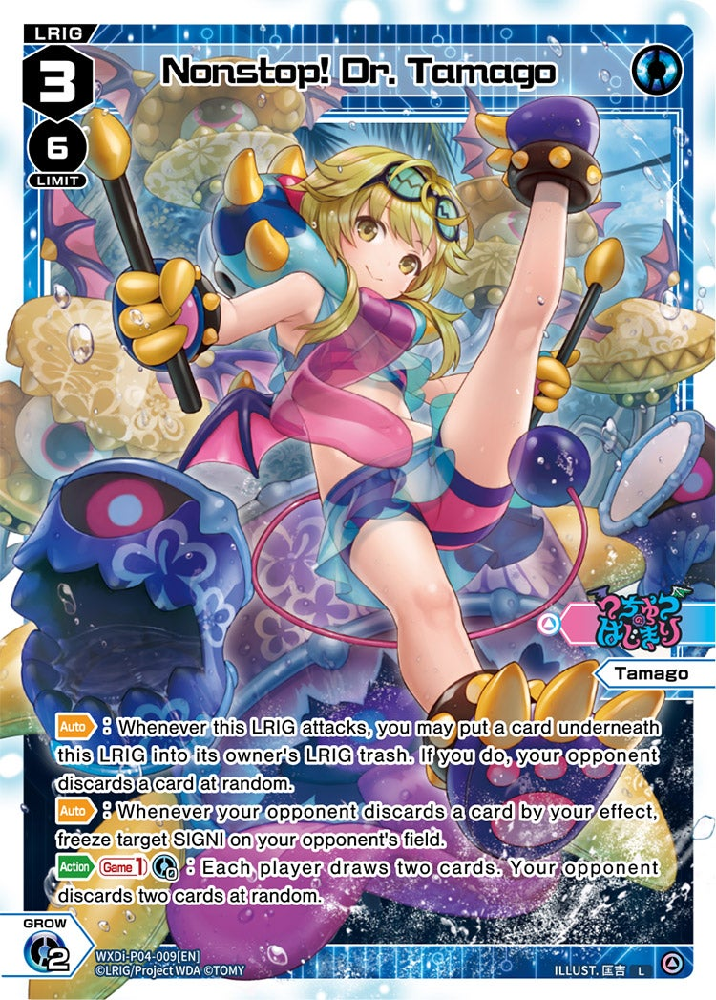

# Nonstop! Dr. Tamago

## Thông tin lá

| Trường | Giá trị |
| --- | --- |
| Mã in | WXDi-P04-009[EN] |
| Set | WXDi-P04[EN] |
| Số thứ tự | 009 |
| Loại thẻ | LRIG |
| Vị trí | LRIG Deck |
| Số bản | — (set booster, không áp dụng) |
| Màu | Xanh dương |
| Độ hiếm | L,SCR,DiR |
| Minh họa | 匡吉 |
| Level | 3 |
| Limit | 6 |
| Power | 0 |
| LRIG type / Class | Tamago |
| Team / Master | UCHU NO HAJIMARI |
| Cost | — |
| Grow cost | 《U》×２ |
| Use timing | — |
| Life Burst | Không |

## Card text chính thức

[Auto]: Whenever this LRIG attacks, you may put a card underneath this LRIG into its owner's LRIG trash. If you do, your opponent discards a card at random.
[Auto]: Whenever your opponent discards a card by your effect, freeze target SIGNI on your opponent's field.
[Action] {1/Game} {Bluex0}: Each player draws two cards. Your opponent discards two cards at random.

## Power text / Life Burst

—

## Ghi chú minh họa
Artist: 匡吉. Ảnh L được tải từ Card List tiếng Anh.

## FAQ chính thức

**Q. If the first [Enter] ability is triggered, does the second [Enter] ability also trigger?**
A. Yes, if your opponent discarded a card by the first [Enter] ability, the second [Enter] ability also triggers. If your opponent has no cards in your opponent's hand and does not discard a card, the second [Enter] ability cannot trigger.

## Ảnh biến thể

- [DiR](../images/WXDi-P04-009D-EN.jpg)
- [SCR](../images/WXDi-P04-009S-EN.jpg)

## Nguồn
[Card List/FAQ chính thức](https://www.takaratomy.co.jp/products/en.wixoss/card/card.html?card_no=WXDi-P04-009%5BEN%5D ) · [Ảnh thẻ](https://www.takaratomy.co.jp/products/en.wixoss/card/thumb/WXDi-P04-009%5BEN%5D.jpg)
