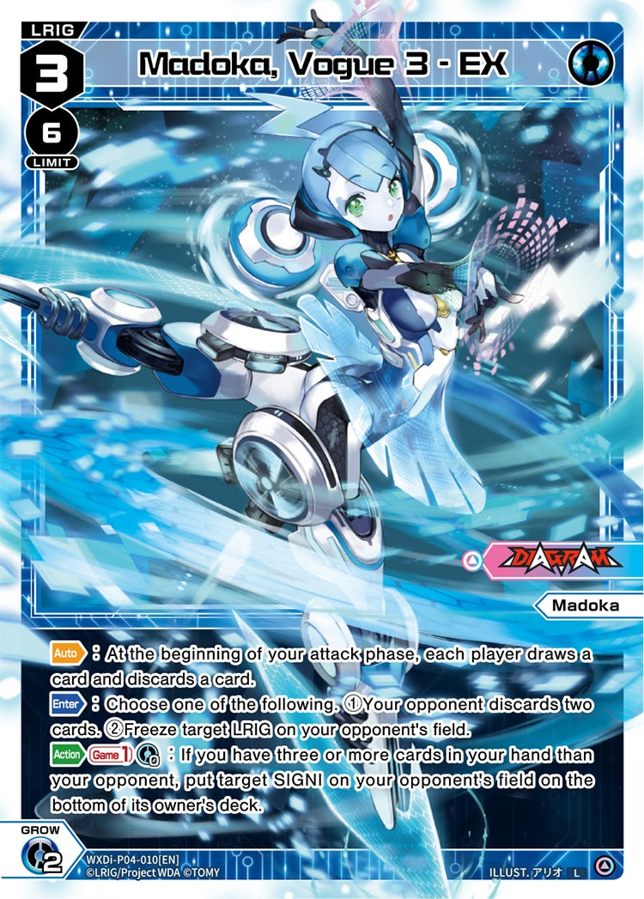

# Madoka, Vogue 3 - EX

## Thông tin lá

| Trường | Giá trị |
| --- | --- |
| Mã in | WXDi-P04-010[EN] |
| Set | WXDi-P04[EN] |
| Số thứ tự | 010 |
| Loại thẻ | LRIG |
| Vị trí | LRIG Deck |
| Số bản | — (set booster, không áp dụng) |
| Màu | Xanh dương |
| Độ hiếm | L,SCR,DiR |
| Minh họa | アリオ |
| Level | 3 |
| Limit | 6 |
| Power | 0 |
| LRIG type / Class | Madoka |
| Team / Master | DIAGRAM |
| Cost | — |
| Grow cost | 《U》×２ |
| Use timing | — |
| Life Burst | Không |

## Card text chính thức

[Auto]: At the beginning of your attack phase, each player draws a card and discards a card.
[Enter]: Choose one of the following. ①Your opponent discards two cards. ②Freeze target LRIG on your opponent's field.
[Action] {1/Game} {Bluex0}: If you have three or more cards in your hand than your opponent, put target SIGNI on your opponent's field on the bottom of its owner's deck.

## Power text / Life Burst

—

## Ghi chú minh họa
Artist: アリオ. Ảnh L được tải từ Card List tiếng Anh.

## FAQ chính thức

**Q. When each player discards a card by [Auto] ability, is there a specific order in which each player discards a card?**
A. Each player discards a card at the same time. Each player chooses a card to discard and puts it in its owner's trash at the same time. You cannot check the card discarded by your opponent and then choose the card you want to discard.

## Ảnh biến thể

- [DiR](../images/WXDi-P04-010D-EN.jpg)
- [SCR](../images/WXDi-P04-010S-EN.jpg)

## Nguồn
[Card List/FAQ chính thức](https://www.takaratomy.co.jp/products/en.wixoss/card/card.html?card_no=WXDi-P04-010%5BEN%5D ) · [Ảnh thẻ](https://www.takaratomy.co.jp/products/en.wixoss/card/thumb/WXDi-P04-010%5BEN%5D.jpg)
