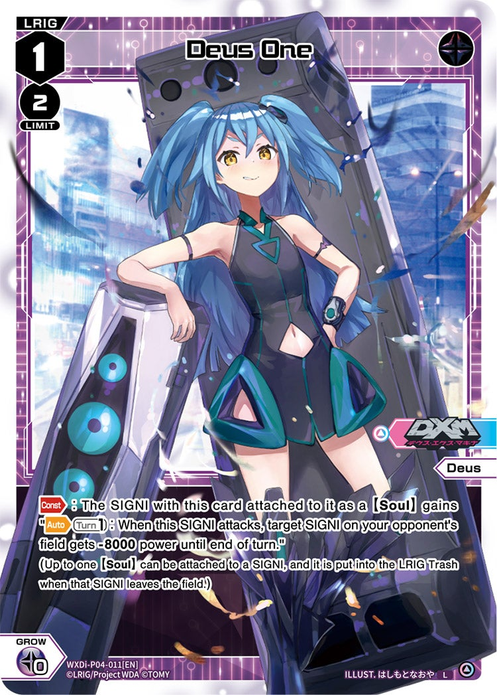

# Deus One

## Thông tin lá

| Trường | Giá trị |
| --- | --- |
| Mã in | WXDi-P04-011[EN] |
| Set | WXDi-P04[EN] |
| Số thứ tự | 011 |
| Loại thẻ | LRIG |
| Vị trí | LRIG Deck |
| Số bản | — (set booster, không áp dụng) |
| Màu | Đen |
| Độ hiếm | L,SCR |
| Minh họa | はしもとなおや |
| Level | 1 |
| Limit | 2 |
| Power | 0 |
| LRIG type / Class | Deus |
| Team / Master | DEUS・EX・MACHINA |
| Cost | — |
| Grow cost | 《B》×０ |
| Use timing | — |
| Life Burst | Không |

## Card text chính thức

[Constant]: The SIGNI with this card attached to it as a 【Soul】 gains "[Auto] {1/Turn}: When this SIGNI attacks, target SIGNI on your opponent's field gets -8000 power until end of turn."
(Up to one 【Soul】 can be attached to a SIGNI, and it is put into the LRIG Trash when that SIGNI leaves the field.)

## Power text / Life Burst

—

## Ghi chú minh họa
Artist: はしもとなおや. Ảnh L được tải từ Card List tiếng Anh.

## FAQ chính thức

**Q. What is 【Soul】?**
A. LRIG may be attached to SIGNI as 【Soul】 by effect. You cannot attach more than two 【Soul】 on a SIGNI. If the SIGNI with a 【Soul】 attached to it leaves the field, 【Soul】 will be put into its owner's LRIG trash by Rule-based action.

## Ảnh biến thể

- [SCR](../images/WXDi-P04-011S-EN.jpg)

## Nguồn
[Card List/FAQ chính thức](https://www.takaratomy.co.jp/products/en.wixoss/card/card.html?card_no=WXDi-P04-011%5BEN%5D ) · [Ảnh thẻ](https://www.takaratomy.co.jp/products/en.wixoss/card/thumb/WXDi-P04-011%5BEN%5D.jpg)
