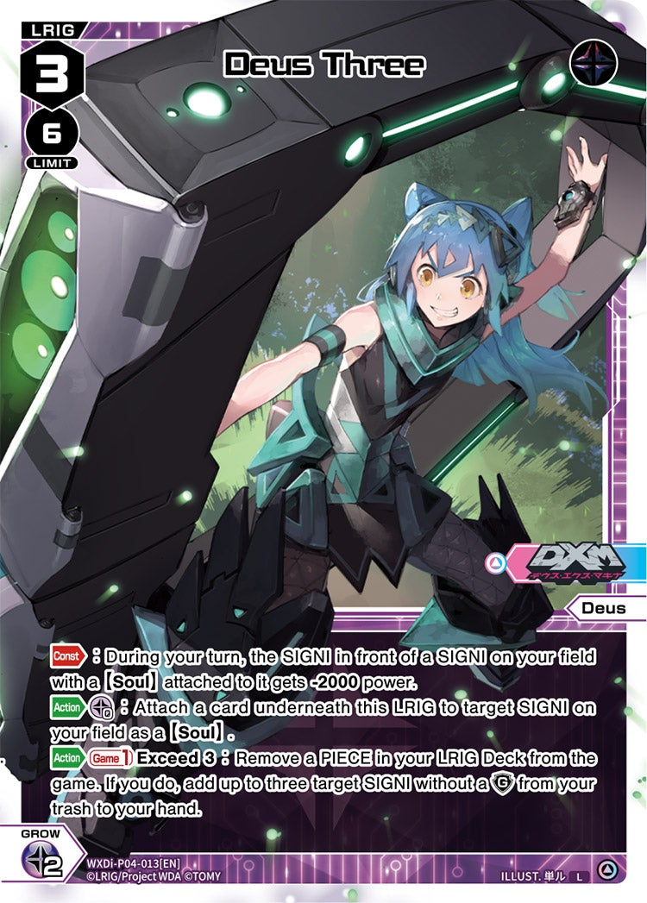

# Deus Three

## Thông tin lá

| Trường | Giá trị |
| --- | --- |
| Mã in | WXDi-P04-013[EN] |
| Set | WXDi-P04[EN] |
| Số thứ tự | 013 |
| Loại thẻ | LRIG |
| Vị trí | LRIG Deck |
| Số bản | — (set booster, không áp dụng) |
| Màu | Đen |
| Độ hiếm | L,SCR,DiR |
| Minh họa | 単ル |
| Level | 3 |
| Limit | 6 |
| Power | 0 |
| LRIG type / Class | Deus |
| Team / Master | DEUS・EX・MACHINA |
| Cost | — |
| Grow cost | 《B》×２ |
| Use timing | — |
| Life Burst | Không |

## Card text chính thức

[Constant]: During your turn, the SIGNI in front of a SIGNI on your field with a 【Soul】 attached to it gets -2000 power.
[Action] {Blackx0}: Attach a card underneath this LRIG to target SIGNI on your field as a 【Soul】.
[Action] {1/Game} Exceed 3: Remove a PIECE in your LRIG Deck from the game. If you do, add up to three target SIGNI without a {Guard Icon} from your trash to your hand.

## Power text / Life Burst

—

## Ghi chú minh họa
Artist: 単ル. Ảnh L được tải từ Card List tiếng Anh.

## FAQ chính thức

**Q. What is 【Soul】?**
A. LRIG may be attached to SIGNI as 【Soul】 by effect. You cannot attach more than two 【Soul】 on a SIGNI. If the SIGNI with a 【Soul】 attached to it leaves the field, 【Soul】 will be put into its owner's LRIG trash by Rule-based action.

## Ảnh biến thể

- [DiR](../images/WXDi-P04-013D-EN.jpg)
- [SCR](../images/WXDi-P04-013S-EN.jpg)

## Nguồn
[Card List/FAQ chính thức](https://www.takaratomy.co.jp/products/en.wixoss/card/card.html?card_no=WXDi-P04-013%5BEN%5D ) · [Ảnh thẻ](https://www.takaratomy.co.jp/products/en.wixoss/card/thumb/WXDi-P04-013%5BEN%5D.jpg)
