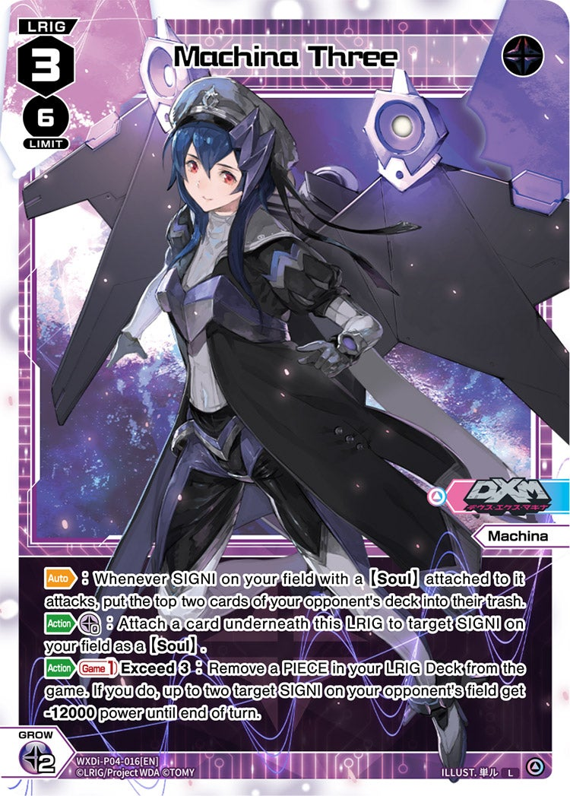

# Machina Three

## Thông tin lá

| Trường | Giá trị |
| --- | --- |
| Mã in | WXDi-P04-016[EN] |
| Set | WXDi-P04[EN] |
| Số thứ tự | 016 |
| Loại thẻ | LRIG |
| Vị trí | LRIG Deck |
| Số bản | — (set booster, không áp dụng) |
| Màu | Đen |
| Độ hiếm | L,SCR,DiR |
| Minh họa | 単ル |
| Level | 3 |
| Limit | 6 |
| Power | 0 |
| LRIG type / Class | Machina |
| Team / Master | DEUS・EX・MACHINA |
| Cost | — |
| Grow cost | 《B》×２ |
| Use timing | — |
| Life Burst | Không |

## Card text chính thức

[Auto]: Whenever SIGNI on your field with a 【Soul】 attached to it attacks, put the top two cards of your opponent's deck into their trash.
[Action] {Blackx0}: Attach a card underneath this LRIG to target SIGNI on your field as a 【Soul】.
[Action] {1/Game} Exceed 3: Remove a PIECE in your LRIG Deck from the game. If you do, up to two target SIGNI on your opponent's field get -12000 power until end of turn.

## Power text / Life Burst

—

## Ghi chú minh họa
Artist: 単ル. Ảnh L được tải từ Card List tiếng Anh.

## FAQ chính thức

**Q. What is 【Soul】?**
A. LRIG may be attached to SIGNI as 【Soul】 by effect. You cannot attach more than two 【Soul】 on a SIGNI. If the SIGNI with a 【Soul】 attached to it leaves the field, 【Soul】 will be put into its owner's LRIG trash by Rule-based action.

**Q. This LRIG's [Auto] ability, and when a SIGNI who gained [Auto] ability by the effect of 【Soul】 attacks. Which [Auto] ability will be resolved first?**
A. Both [Auto] abilities are triggered when a SIGNI with 【Soul】 attached attacks. If there are more than one triggered abilities, they can be resolved in any order.

## Ảnh biến thể

- [DiR](../images/WXDi-P04-016D-EN.jpg)
- [SCR](../images/WXDi-P04-016S-EN.jpg)

## Nguồn
[Card List/FAQ chính thức](https://www.takaratomy.co.jp/products/en.wixoss/card/card.html?card_no=WXDi-P04-016%5BEN%5D ) · [Ảnh thẻ](https://www.takaratomy.co.jp/products/en.wixoss/card/thumb/WXDi-P04-016%5BEN%5D.jpg)
