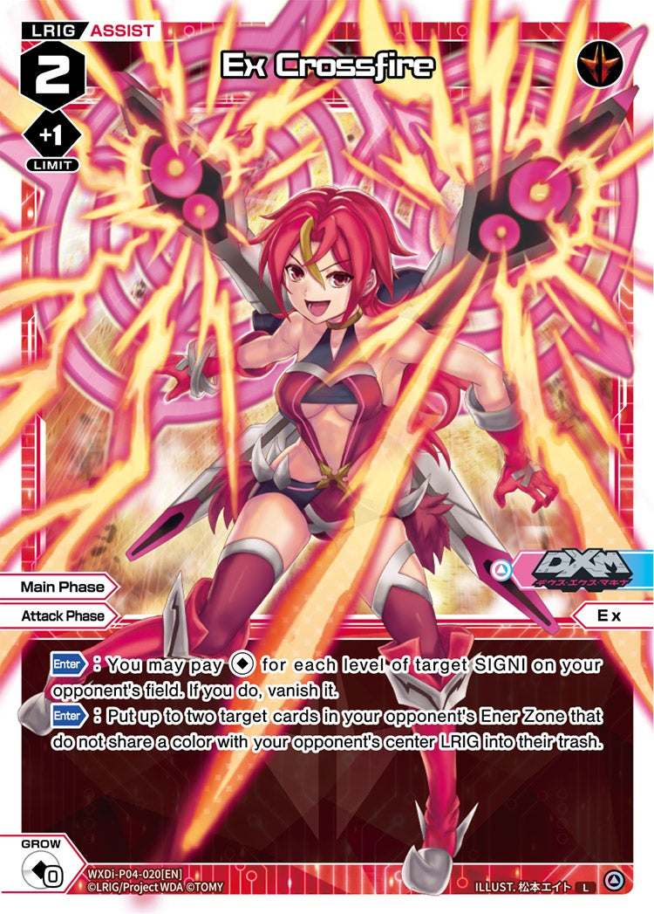

# Ex Crossfire

## Thông tin lá

| Trường | Giá trị |
| --- | --- |
| Mã in | WXDi-P04-020[EN] |
| Set | WXDi-P04[EN] |
| Số thứ tự | 020 |
| Loại thẻ | ASSIST LRIG |
| Vị trí | LRIG Deck |
| Số bản | — (set booster, không áp dụng) |
| Màu | Đỏ |
| Độ hiếm | L,L(P) |
| Minh họa | 松本エイト |
| Level | 2 |
| Limit | ＋1 |
| Power | 0 |
| LRIG type / Class | Ex |
| Team / Master | DEUS・EX・MACHINA |
| Cost | — |
| Grow cost | 《C》×０ |
| Use timing | Main Phase
Attack Phase |
| Life Burst | Không |

## Card text chính thức

[Enter]: You may pay {Colorless} for each level of target SIGNI on your opponent's field. If you do, vanish it.
[Enter]: Put up to two target cards in your opponent's Ener Zone that do not share a color with your opponent's center LRIG into their trash.

## Power text / Life Burst

—

## Ghi chú minh họa
Artist: 松本エイト. Ảnh L được tải từ Card List tiếng Anh.

## FAQ chính thức

**Q. May I put target "Servant ♯" in my opponent's Ener Zone into its trash?**
A. Yes, you may put it into its trash. "Servant ♯" is a colorless SIGNI, so it has not color. It has 【Multi Ener】 ability, but this ability is "When paying costs, this card can be used as any color.". This ability cannot change SIGNI's color.

## Ảnh biến thể

- [L(P)](../images/WXDi-P04-020P-EN.jpg)

## Nguồn
[Card List/FAQ chính thức](https://www.takaratomy.co.jp/products/en.wixoss/card/card.html?card_no=WXDi-P04-020%5BEN%5D ) · [Ảnh thẻ](https://www.takaratomy.co.jp/products/en.wixoss/card/thumb/WXDi-P04-020%5BEN%5D.jpg)
