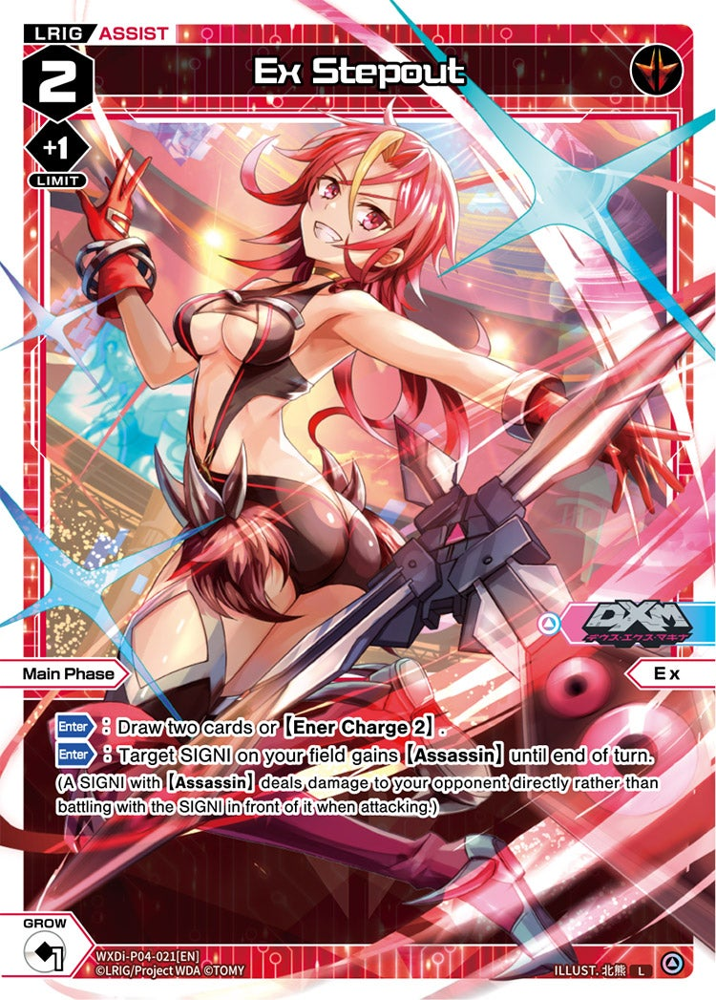

# Ex Stepout

## Thông tin lá

| Trường | Giá trị |
| --- | --- |
| Mã in | WXDi-P04-021[EN] |
| Set | WXDi-P04[EN] |
| Số thứ tự | 021 |
| Loại thẻ | ASSIST LRIG |
| Vị trí | LRIG Deck |
| Số bản | — (set booster, không áp dụng) |
| Màu | Đỏ |
| Độ hiếm | L,L(P) |
| Minh họa | 北熊 |
| Level | 2 |
| Limit | ＋1 |
| Power | 0 |
| LRIG type / Class | Ex |
| Team / Master | DEUS・EX・MACHINA |
| Cost | — |
| Grow cost | 《C》×１ |
| Use timing | Main Phase |
| Life Burst | Không |

## Card text chính thức

[Enter]: Draw two cards or 【Ener Charge 2】.
[Enter]: Target SIGNI on your field gains 【Assassin】 until end of turn.
(A SIGNI with 【Assassin】 deals damage to your opponent directly rather than battling with the SIGNI in front of it when attacking.)

## Power text / Life Burst

—

## Ghi chú minh họa
Artist: 北熊. Ảnh L được tải từ Card List tiếng Anh.

## FAQ chính thức

— (không có FAQ riêng cho mã này trên trang FAQ tiếng Anh.)

## Ảnh biến thể

- [L(P)](../images/WXDi-P04-021P-EN.jpg)

## Nguồn
[Card List/FAQ chính thức](https://www.takaratomy.co.jp/products/en.wixoss/card/card.html?card_no=WXDi-P04-021%5BEN%5D ) · [Ảnh thẻ](https://www.takaratomy.co.jp/products/en.wixoss/card/thumb/WXDi-P04-021%5BEN%5D.jpg)
