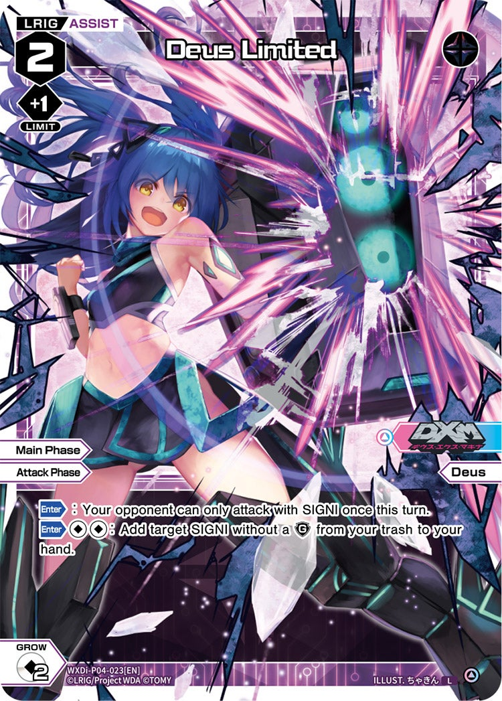

# Deus Limited

## Thông tin lá

| Trường | Giá trị |
| --- | --- |
| Mã in | WXDi-P04-023[EN] |
| Set | WXDi-P04[EN] |
| Số thứ tự | 023 |
| Loại thẻ | ASSIST LRIG |
| Vị trí | LRIG Deck |
| Số bản | — (set booster, không áp dụng) |
| Màu | Đen |
| Độ hiếm | L,L(P) |
| Minh họa | ちゃきん |
| Level | 2 |
| Limit | ＋1 |
| Power | 0 |
| LRIG type / Class | Deus |
| Team / Master | DEUS・EX・MACHINA |
| Cost | — |
| Grow cost | 《C》×２ |
| Use timing | Main Phase
Attack Phase |
| Life Burst | Không |

## Card text chính thức

[Enter]: Your opponent can only attack with SIGNI once this turn.
[Enter] {Colorless} {Colorless}: Add target SIGNI without a {Guard Icon} from your trash to your hand.

## Power text / Life Burst

—

## Ghi chú minh họa
Artist: ちゃきん. Ảnh L được tải từ Card List tiếng Anh.

## FAQ chính thức

— (không có FAQ riêng cho mã này trên trang FAQ tiếng Anh.)

## Ảnh biến thể

- [L(P)](../images/WXDi-P04-023P-EN.jpg)

## Nguồn
[Card List/FAQ chính thức](https://www.takaratomy.co.jp/products/en.wixoss/card/card.html?card_no=WXDi-P04-023%5BEN%5D ) · [Ảnh thẻ](https://www.takaratomy.co.jp/products/en.wixoss/card/thumb/WXDi-P04-023%5BEN%5D.jpg)
