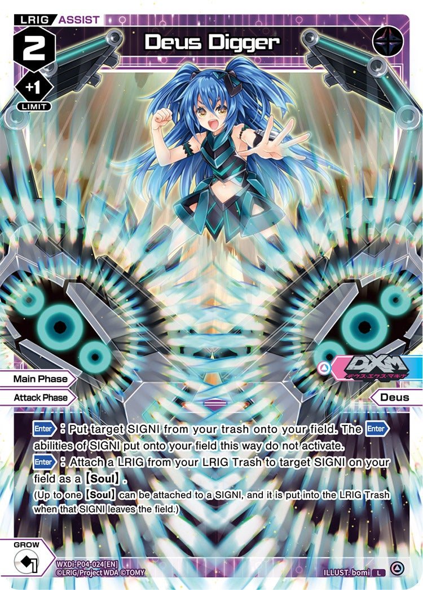

# Deus Digger

## Thông tin lá

| Trường | Giá trị |
| --- | --- |
| Mã in | WXDi-P04-024[EN] |
| Set | WXDi-P04[EN] |
| Số thứ tự | 024 |
| Loại thẻ | ASSIST LRIG |
| Vị trí | LRIG Deck |
| Số bản | — (set booster, không áp dụng) |
| Màu | Đen |
| Độ hiếm | L,L(P) |
| Minh họa | bomi |
| Level | 2 |
| Limit | ＋1 |
| Power | 0 |
| LRIG type / Class | Deus |
| Team / Master | DEUS・EX・MACHINA |
| Cost | — |
| Grow cost | 《C》×１ |
| Use timing | Main Phase
Attack Phase |
| Life Burst | Không |

## Card text chính thức

[Enter]: Put target SIGNI from your trash onto your field. The [Enter] abilities of SIGNI put onto your field this way do not activate.
[Enter]: Attach a LRIG from your LRIG Trash to target SIGNI on your field as a 【Soul】.
(Up to one 【Soul】 can be attached to a SIGNI, and it is put into the LRIG Trash when that SIGNI leaves the field.)

## Power text / Life Burst

—

## Ghi chú minh họa
Artist: bomi. Ảnh L được tải từ Card List tiếng Anh.

## FAQ chính thức

**Q. What is 【Soul】?**
A. LRIG may be attached to SIGNI as 【Soul】 by effect. You cannot attach more than two 【Soul】 on a SIGNI. If the SIGNI with a 【Soul】 attached to it leaves the field, 【Soul】 will be put into its owner's LRIG trash by Rule-based action.

**Q. When there are no SIGNIs on your field, I put this LRIG onto my field. May I put a SIGNI from my trash to my field by the first [Enter] ability, then I attach a 【Soul】 to that SIGNI by the second [Enter] ability?**
A. Yes, you can.

## Ảnh biến thể

- [L(P)](../images/WXDi-P04-024P-EN.jpg)

## Nguồn
[Card List/FAQ chính thức](https://www.takaratomy.co.jp/products/en.wixoss/card/card.html?card_no=WXDi-P04-024%5BEN%5D ) · [Ảnh thẻ](https://www.takaratomy.co.jp/products/en.wixoss/card/thumb/WXDi-P04-024%5BEN%5D.jpg)
