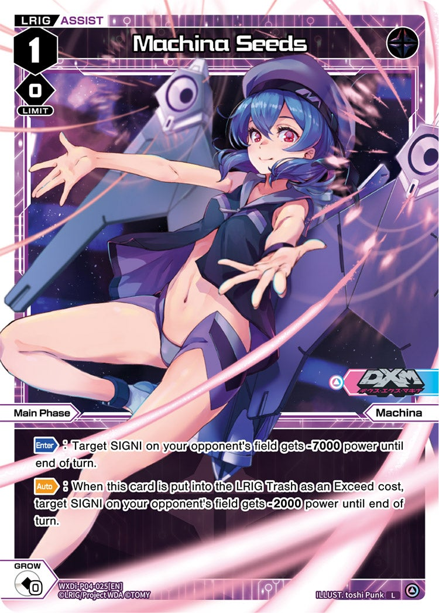

# Machina Seeds

## Thông tin lá

| Trường | Giá trị |
| --- | --- |
| Mã in | WXDi-P04-025[EN] |
| Set | WXDi-P04[EN] |
| Số thứ tự | 025 |
| Loại thẻ | ASSIST LRIG |
| Vị trí | LRIG Deck |
| Số bản | — (set booster, không áp dụng) |
| Màu | Đen |
| Độ hiếm | L,L(P) |
| Minh họa | toshi Punk |
| Level | 1 |
| Limit | 0 |
| Power | 0 |
| LRIG type / Class | Machina |
| Team / Master | DEUS・EX・MACHINA |
| Cost | — |
| Grow cost | 《C》×０ |
| Use timing | Main Phase |
| Life Burst | Không |

## Card text chính thức

[Enter]: Target SIGNI on your opponent's field gets -7000 power until end of turn.

[Auto]: When this card is put into the LRIG Trash as an Exceed cost, target SIGNI on your opponent's field gets -2000 power until end of turn.

## Power text / Life Burst

—

## Ghi chú minh họa
Artist: toshi Punk. Ảnh L được tải từ Card List tiếng Anh.

## FAQ chính thức

**Q. [Auto] ability triggered when put this card into its owner's trash as Exceed's cost, and some ability played by Exceed's cost. Which of [Auto] ability and some ability will be resolved first?**
A. If you paid A as a cost and declare play some ability will be processed first. Then, you process the triggered [Auto] ability of this card.

## Ảnh biến thể

- [L(P)](../images/WXDi-P04-025P-EN.jpg)

## Nguồn
[Card List/FAQ chính thức](https://www.takaratomy.co.jp/products/en.wixoss/card/card.html?card_no=WXDi-P04-025%5BEN%5D ) · [Ảnh thẻ](https://www.takaratomy.co.jp/products/en.wixoss/card/thumb/WXDi-P04-025%5BEN%5D.jpg)
