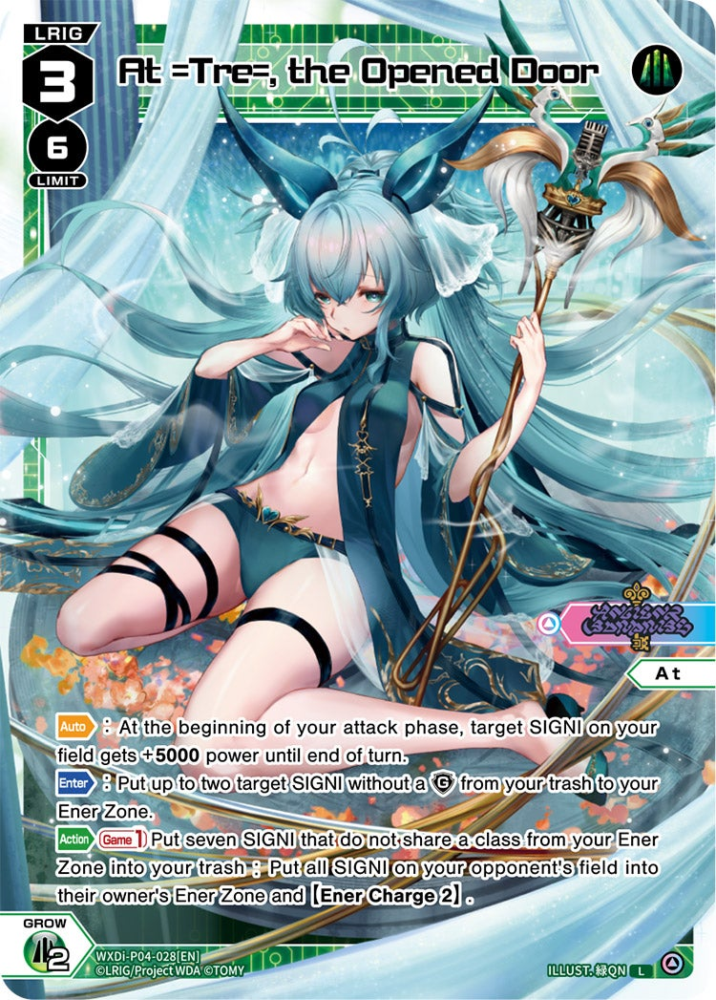

# At =Tre=, the Opened Door

## Thông tin lá

| Trường | Giá trị |
| --- | --- |
| Mã in | WXDi-P04-028[EN] |
| Set | WXDi-P04[EN] |
| Số thứ tự | 028 |
| Loại thẻ | LRIG |
| Vị trí | LRIG Deck |
| Số bản | — (set booster, không áp dụng) |
| Màu | Xanh lá |
| Độ hiếm | L,SCR,DiR |
| Minh họa | 緑QN |
| Level | 3 |
| Limit | 6 |
| Power | 0 |
| LRIG type / Class | At |
| Team / Master | Ancient Surprise |
| Cost | — |
| Grow cost | 《G》×２ |
| Use timing | — |
| Life Burst | Không |

## Card text chính thức

[Auto]: At the beginning of your attack phase, target SIGNI on your field gets +5000 power until end of turn.
[Enter]: Put up to two target SIGNI without a {Guard Icon} from your trash to your Ener Zone.
[Action] {1/Game} Put seven SIGNI that do not share a class from your Ener Zone into your trash: Put all SIGNI on your opponent's field into their owner's Ener Zone and 【Ener Charge 2】.

## Power text / Life Burst

—

## Ghi chú minh họa
Artist: 緑QN. Ảnh L được tải từ Card List tiếng Anh.

## FAQ chính thức

**Q. What exactly does "seven SIGNI that do not share a class" mean?**
A. Seen from each of the seven SIGNI, the other six SIGNI do not have the same class as itself. This effect cannot resolve if even one set of seven cards has SIGNI of the same class.

## Ảnh biến thể

- [DiR](../images/WXDi-P04-028D-EN.jpg)
- [SCR](../images/WXDi-P04-028S-EN.jpg)

## Nguồn
[Card List/FAQ chính thức](https://www.takaratomy.co.jp/products/en.wixoss/card/card.html?card_no=WXDi-P04-028%5BEN%5D ) · [Ảnh thẻ](https://www.takaratomy.co.jp/products/en.wixoss/card/thumb/WXDi-P04-028%5BEN%5D.jpg)
