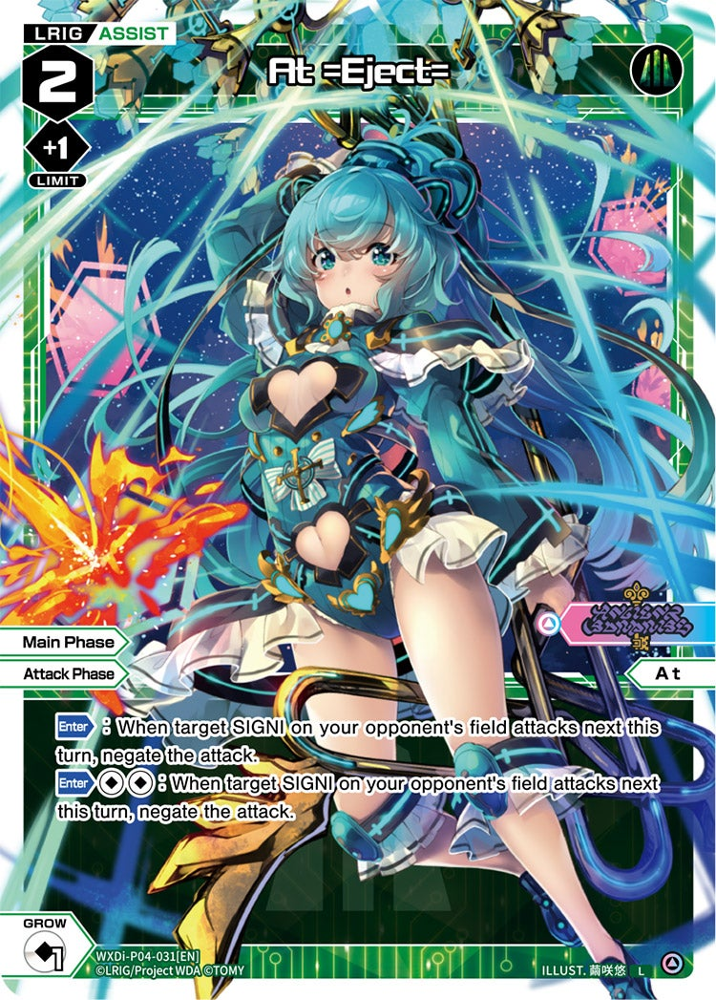

# At =Eject=

## Thông tin lá

| Trường | Giá trị |
| --- | --- |
| Mã in | WXDi-P04-031[EN] |
| Set | WXDi-P04[EN] |
| Số thứ tự | 031 |
| Loại thẻ | ASSIST LRIG |
| Vị trí | LRIG Deck |
| Số bản | — (set booster, không áp dụng) |
| Màu | Xanh lá |
| Độ hiếm | L,L(P) |
| Minh họa | 繭咲悠 |
| Level | 2 |
| Limit | ＋1 |
| Power | 0 |
| LRIG type / Class | At |
| Team / Master | Ancient Surprise |
| Cost | — |
| Grow cost | 《C》×１ |
| Use timing | Main Phase / Attack Phase |
| Life Burst | Không |

## Card text chính thức

[Enter]: When target SIGNI on your opponent's field attacks next this turn, negate the attack.
[Enter] {Colorless} {Colorless}: When target SIGNI on your opponent's field attacks next this turn, negate the attack.

## Power text / Life Burst

—

## Ghi chú minh họa
Artist: 繭咲悠. Ảnh L được tải từ Card List tiếng Anh.

## FAQ chính thức

**Q. Does "When target SIGNI on your opponent's field attacks next this turn" mean that if your opponent will be start next SIGNI Attak Step, negated the next attack that would be targeted SIGNI's attacks to me or my SIGNI this turn, or when the opponent starts the second, third or more SIGNI Attack step this turn, target SIGNI negated when it attacks. Which one is right?**
A. The latter is right. Regardless of which order your opponent attack in, the target SIGNI's attack will be negated.

**Q. May I target the same SIGNI when both [Enter] abilities triggers?**
A. You may target the same SIGNI, however if the SIGNI attacks next time this turn when targeted by both effects, the both "negate the attack" by both effects are triggered and resolved at the same time, so even if the SIGNI attacks a second time with some ability up, the second attack cannot be negated.

## Ảnh biến thể

- [L(P)](../images/WXDi-P04-031P-EN.jpg)

## Nguồn
[Card List/FAQ chính thức](https://www.takaratomy.co.jp/products/en.wixoss/card/card.html?card_no=WXDi-P04-031%5BEN%5D ) · [Ảnh thẻ](https://www.takaratomy.co.jp/products/en.wixoss/card/thumb/WXDi-P04-031%5BEN%5D.jpg)
