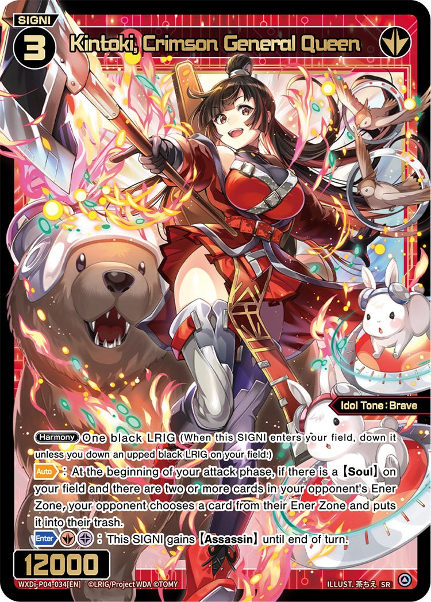

# Kintoki, Crimson General Queen

## Thông tin lá

| Trường | Giá trị |
| --- | --- |
| Mã in | WXDi-P04-034[EN] |
| Set | WXDi-P04[EN] |
| Số thứ tự | 034 |
| Loại thẻ | SIGNI |
| Vị trí | Main Deck |
| Số bản | — (set booster, không áp dụng) |
| Màu | Đỏ |
| Độ hiếm | SR |
| Minh họa | 茶ちえ |
| Level | 3 |
| Limit | — |
| Power | 12000 |
| LRIG type / Class | Idol Tone：Brave |
| Team / Master | — |
| Cost | — |
| Grow cost | — |
| Use timing | — |
| Life Burst | Không |

## Card text chính thức

[Harmony] One black LRIG (When this SIGNI enters your field, down it unless you down an upped black LRIG on your field.)
[Auto]: At the beginning of your attack phase, if there is a 【Soul】 on your field and there are two or more cards in your opponent's Ener Zone, your opponent chooses a card from their Ener Zone and puts it into their trash.
[Enter] {Red} {Black}: This SIGNI gains 【Assassin】 until end of turn.

## Power text / Life Burst

—

## Ghi chú minh họa
Artist: 茶ちえ. Ảnh SR được tải từ Card List tiếng Anh.

## FAQ chính thức

**Q. What is 【Harmony】?**
A. When a SIGNI with 【Harmony】 enters the field, it will be downed unless it down an LRIG that meets the requirements. If you have a LIRG that meets the requirements, you can also choose to down this SIGNI. Since 【Harmony】 is not [Enter] ability, it will also trigger when it enters the field with the effect "The [Enter] abilities do not activate.".

## Nguồn
[Card List/FAQ chính thức](https://www.takaratomy.co.jp/products/en.wixoss/card/card.html?card_no=WXDi-P04-034%5BEN%5D ) · [Ảnh thẻ](https://www.takaratomy.co.jp/products/en.wixoss/card/thumb/WXDi-P04-034%5BEN%5D.jpg)
