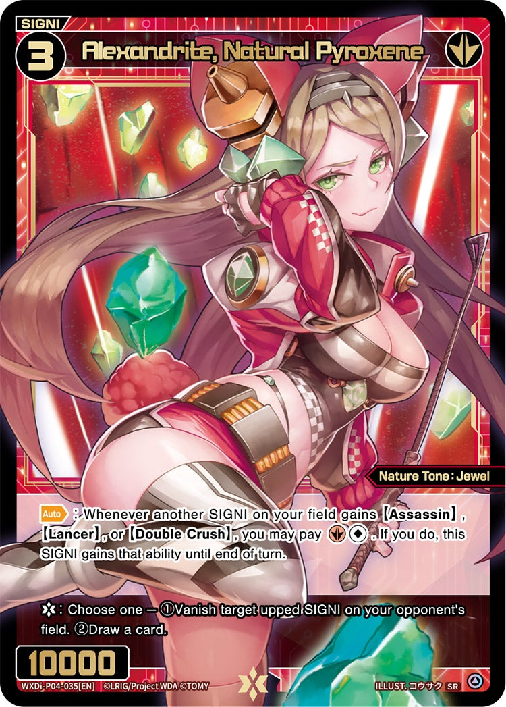

# Alexandrite, Natural Pyroxene

## Thông tin lá

| Trường | Giá trị |
| --- | --- |
| Mã in | WXDi-P04-035[EN] |
| Set | WXDi-P04[EN] |
| Số thứ tự | 035 |
| Loại thẻ | SIGNI |
| Vị trí | Main Deck |
| Số bản | — (set booster, không áp dụng) |
| Màu | Đỏ |
| Độ hiếm | SR |
| Minh họa | コウサク |
| Level | 3 |
| Limit | — |
| Power | 10000 |
| LRIG type / Class | Nature Tone：Jewel |
| Team / Master | — |
| Cost | — |
| Grow cost | — |
| Use timing | — |
| Life Burst | Có |

## Card text chính thức

[Auto]: Whenever another SIGNI on your field gains 【Assassin】, 【Lancer】, or 【Double Crush】, you may pay {Red} {Colorless}. If you do, this SIGNI gains that ability until end of turn.

## Power text / Life Burst

Choose one — ①Vanish target upped SIGNI on your opponent's field. ②Draw a card.

## Ghi chú minh họa
Artist: コウサク. Ảnh SR được tải từ Card List tiếng Anh.

## FAQ chính thức

**Q. My other SIGNI got 【Assassin】 and 【Double Crush】 by one effect. How do me process this card's [Auto] ability?**
A. [Auto] ability will trigger for each of 【Assassin】 and 【Double Crush】. So if you pay {Red} {Red} {Colorless} {Colorless}, this SIGNI gains 【Assassin】 and 【Double Crush】. Also you may pay {Red} {Colorless} and this SIGNI gains 【Assassin】 or 【Double Crush】. Or you may choose not to pay the cost and gain any ability neither.

## Nguồn
[Card List/FAQ chính thức](https://www.takaratomy.co.jp/products/en.wixoss/card/card.html?card_no=WXDi-P04-035%5BEN%5D ) · [Ảnh thẻ](https://www.takaratomy.co.jp/products/en.wixoss/card/thumb/WXDi-P04-035%5BEN%5D.jpg)
