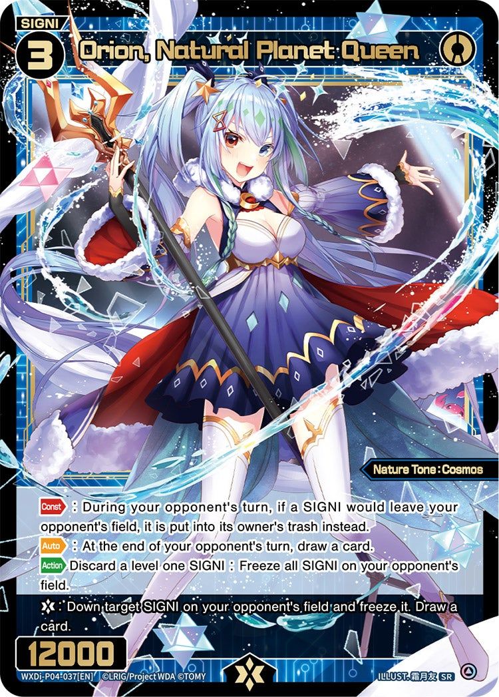

# Orion, Natural Planet Queen

## Thông tin lá

| Trường | Giá trị |
| --- | --- |
| Mã in | WXDi-P04-037[EN] |
| Set | WXDi-P04[EN] |
| Số thứ tự | 037 |
| Loại thẻ | SIGNI |
| Vị trí | Main Deck |
| Số bản | — (set booster, không áp dụng) |
| Màu | Xanh dương |
| Độ hiếm | SR |
| Minh họa | 霜月友 |
| Level | 3 |
| Limit | — |
| Power | 12000 |
| LRIG type / Class | Nature Tone：Cosmos |
| Team / Master | — |
| Cost | — |
| Grow cost | — |
| Use timing | — |
| Life Burst | Có |

## Card text chính thức

[Constant]: During your opponent's turn, if a SIGNI would leave your opponent's field, it is put into its owner's trash instead.
[Auto]: At the end of your opponent's turn, draw a card.
[Action] Discard a level one SIGNI: Freeze all SIGNI on your opponent's field.

## Power text / Life Burst

Down target SIGNI on your opponent's field and freeze it. Draw a card.

## Ghi chú minh họa
Artist: 霜月友. Ảnh SR được tải từ Card List tiếng Anh.

## FAQ chính thức

**Q. During my opponent's turn, I vanished my opponent's "Giroppon, Code: Labyrinth" by some effect. Where is "Giroppon, Code: Labyrinth" placed?**
A. "Giroppon, Code: Labyrinth" has the ability to "[Const]: During your turn, this SIGNI cannot be moved from the field to anywhere other than the Ener Zone by your opponent's effects.". So it cannot put into your opponent's trash instead by some effect. At as a result, it put into your opponent's Ener Zone.

**Q. During my opponent's turn, I vanished my opponent's "Giroppon, Code: Labyrinth" in battle. Where is "Giroppon, Code: Labyrinth" placed?**
A. Since "Giroppon, Code: Labyrinth" was vanished in battle, it will be put into your opponent's trash instead Ener Zone.
"Giroppon, Code: Labyrinth" has the ability to "[Const]: During your turn, this SIGNI cannot be moved from the field to anywhere other than the Ener Zone by your opponent's effects.". This is a result of the battle, the place where it is placed has changed, it is not the result of the effect. So ability of "Giroppon, Code: Labyrinth" does not affect. Because [Const] ability of "Orion, Natural Planet Queen" does not mean "the ability to move the place where the card is placed.".

## Nguồn
[Card List/FAQ chính thức](https://www.takaratomy.co.jp/products/en.wixoss/card/card.html?card_no=WXDi-P04-037%5BEN%5D ) · [Ảnh thẻ](https://www.takaratomy.co.jp/products/en.wixoss/card/thumb/WXDi-P04-037%5BEN%5D.jpg)
