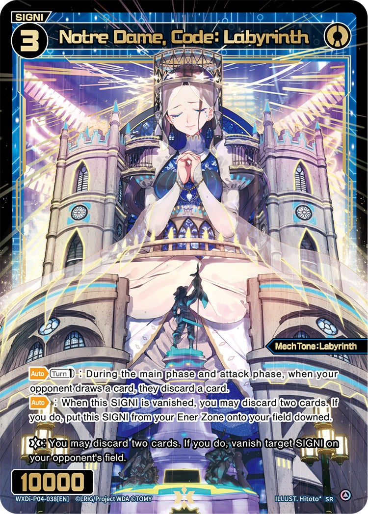

# Notre Dame, Code: Labyrinth

## Thông tin lá

| Trường | Giá trị |
| --- | --- |
| Mã in | WXDi-P04-038[EN] |
| Set | WXDi-P04[EN] |
| Số thứ tự | 038 |
| Loại thẻ | SIGNI |
| Vị trí | Main Deck |
| Số bản | — (set booster, không áp dụng) |
| Màu | Xanh dương |
| Độ hiếm | SR |
| Minh họa | Hitoto* |
| Level | 3 |
| Limit | — |
| Power | 10000 |
| LRIG type / Class | Mech Tone：Labyrinth |
| Team / Master | — |
| Cost | — |
| Grow cost | — |
| Use timing | — |
| Life Burst | Có |

## Card text chính thức

[Auto] {1/Turn}: During the main phase and attack phase, when your opponent draws a card, they discard a card.
[Auto]: When this SIGNI is vanished, you may discard two cards. If you do, put this SIGNI from your Ener Zone onto your field downed.

## Power text / Life Burst

You may discard two cards. If you do, vanish target SIGNI on your opponent's field.

## Ghi chú minh họa
Artist: Hitoto*. Ảnh SR được tải từ Card List tiếng Anh.

## FAQ chính thức

**Q. If your opponent resolve the effect ot "draw two cards", when does the first [Auto] ability trigger?**
A. The first [Auto] ability triggers when your opponent draws a card, but the triggered [Auto] ability cannot be resolved while your opponent's effect is being processed. So this [Auto] ability will be resolved after your opponent's effect have been processed. If the effect is just "draw two cards", this effect triggered after drawing two cards will be resolved only once, and your opponent discards a card.

**Q. When you put this SIGNI from your Ener Zone with the second [Auto] ability, do I put this SIGNI onto my SIGNI Zone where the original this SIGNI was?**
A. No, if you not have SIGNI on your SIGNI Zone, you may putt this card onto your other SIGNI Zone.

## Nguồn
[Card List/FAQ chính thức](https://www.takaratomy.co.jp/products/en.wixoss/card/card.html?card_no=WXDi-P04-038%5BEN%5D ) · [Ảnh thẻ](https://www.takaratomy.co.jp/products/en.wixoss/card/thumb/WXDi-P04-038%5BEN%5D.jpg)
