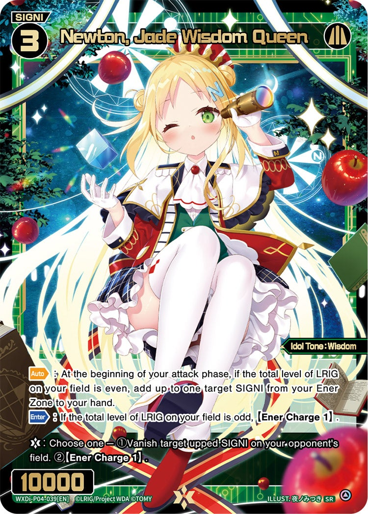

# Newton, Jade Wisdom Queen

## Thông tin lá

| Trường | Giá trị |
| --- | --- |
| Mã in | WXDi-P04-039[EN] |
| Set | WXDi-P04[EN] |
| Số thứ tự | 039 |
| Loại thẻ | SIGNI |
| Vị trí | Main Deck |
| Số bản | — (set booster, không áp dụng) |
| Màu | Xanh lá |
| Độ hiếm | SR |
| Minh họa | 夜ノみつき |
| Level | 3 |
| Limit | — |
| Power | 10000 |
| LRIG type / Class | Idol Tone：Wisdom |
| Team / Master | — |
| Cost | — |
| Grow cost | — |
| Use timing | — |
| Life Burst | Có |

## Card text chính thức

[Auto]: At the beginning of your attack phase, if the total level of LRIG on your field is even, add up to one target SIGNI from your Ener Zone to your hand.
[Enter]: If the total level of LRIG on your field is odd, 【Ener Charge 1】.

## Power text / Life Burst

Choose one — ①Vanish target upped SIGNI on your opponent's field. ②【Ener Charge 1】.

## Ghi chú minh họa
Artist: 夜ノみつき. Ảnh SR được tải từ Card List tiếng Anh.

## FAQ chính thức

— (không có FAQ riêng cho mã này trên trang FAQ tiếng Anh.)

## Nguồn
[Card List/FAQ chính thức](https://www.takaratomy.co.jp/products/en.wixoss/card/card.html?card_no=WXDi-P04-039%5BEN%5D ) · [Ảnh thẻ](https://www.takaratomy.co.jp/products/en.wixoss/card/thumb/WXDi-P04-039%5BEN%5D.jpg)
