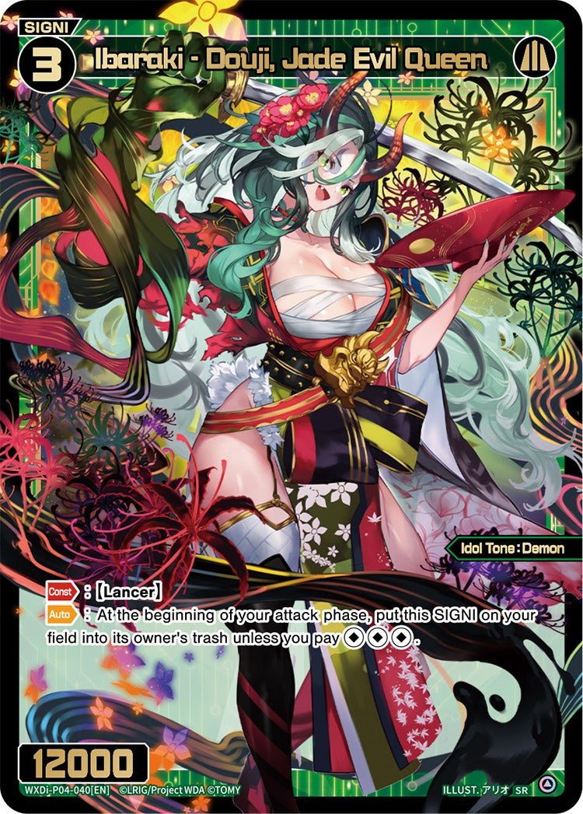

# Ibaraki - Douji, Jade Evil Queen

## Thông tin lá

| Trường | Giá trị |
| --- | --- |
| Mã in | WXDi-P04-040[EN] |
| Set | WXDi-P04[EN] |
| Số thứ tự | 040 |
| Loại thẻ | SIGNI |
| Vị trí | Main Deck |
| Số bản | — (set booster, không áp dụng) |
| Màu | Xanh lá |
| Độ hiếm | SR |
| Minh họa | アリオ |
| Level | 3 |
| Limit | — |
| Power | 12000 |
| LRIG type / Class | Idol Tone：Demon |
| Team / Master | — |
| Cost | — |
| Grow cost | — |
| Use timing | — |
| Life Burst | Không |

## Card text chính thức

[Constant]: 【Lancer】
[Auto]: At the beginning of your attack phase, put this SIGNI on your field into its owner's trash unless you pay {Colorless} {Colorless} {Colorless}.

## Power text / Life Burst

—

## Ghi chú minh họa
Artist: アリオ. Ảnh SR được tải từ Card List tiếng Anh.

## FAQ chính thức

**Q. At the beginning my attack phase, do I need pay {Colorless} {Colorless} {Colorless} when your opponent's "Antnest, Code: Maze" in front of this SIGNI?**
A. Yes, you need do it. You must put this SIGNI on your field into its owner's trash unless you pay {Colorless} {Colorless} {Colorless}. Both abilities are [Auto] abilities that trigger in the attack phase, but resolve your ”Ibaraki - Douji, Jade Evil Queen”'s [Auto] ability as a turn player first.

## Nguồn
[Card List/FAQ chính thức](https://www.takaratomy.co.jp/products/en.wixoss/card/card.html?card_no=WXDi-P04-040%5BEN%5D ) · [Ảnh thẻ](https://www.takaratomy.co.jp/products/en.wixoss/card/thumb/WXDi-P04-040%5BEN%5D.jpg)
