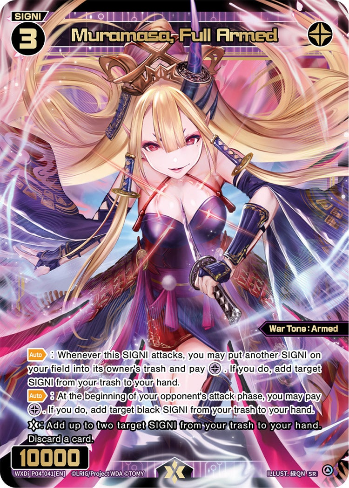

# Muramasa, Full Armed

## Thông tin lá

| Trường | Giá trị |
| --- | --- |
| Mã in | WXDi-P04-041[EN] |
| Set | WXDi-P04[EN] |
| Số thứ tự | 041 |
| Loại thẻ | SIGNI |
| Vị trí | Main Deck |
| Số bản | — (set booster, không áp dụng) |
| Màu | Đen |
| Độ hiếm | SR |
| Minh họa | 緑QN |
| Level | 3 |
| Limit | — |
| Power | 10000 |
| LRIG type / Class | War Tone：Armed |
| Team / Master | — |
| Cost | — |
| Grow cost | — |
| Use timing | — |
| Life Burst | Có |

## Card text chính thức

[Auto]: Whenever this SIGNI attacks, you may put another SIGNI on your field into its owner's trash and pay {Black}. If you do, add target SIGNI from your trash to your hand.
[Auto]: At the beginning of your opponent's attack phase, you may pay {Black}. If you do, add target black SIGNI from your trash to your hand.

## Power text / Life Burst

Add up to two target SIGNI from your trash to your hand. Discard a card.

## Ghi chú minh họa
Artist: 緑QN. Ảnh SR được tải từ Card List tiếng Anh.

## FAQ chính thức

**Q. For the first [Enter] ability, may I put another SIGNI from my field into my trash first, then I target that SIGNI and add it into my hand from my trash when I paid {Black}?**
A. No, you cannot. You need target a SIGNI in your trash first, then put another SIGNI from your field into your trash and pay {Black}. It also cannot target a SIGNI put into the trash from the Ener Zone to pay for the cost {black}. This is also true for the second [Auto] ability.

**Q. For the first [Enter] ability, may I only do either put another SIGNI from my field into my trash or pay {Black}?**
A. No, only if you can do both, you can choose to do both or not.

## Nguồn
[Card List/FAQ chính thức](https://www.takaratomy.co.jp/products/en.wixoss/card/card.html?card_no=WXDi-P04-041%5BEN%5D ) · [Ảnh thẻ](https://www.takaratomy.co.jp/products/en.wixoss/card/thumb/WXDi-P04-041%5BEN%5D.jpg)
