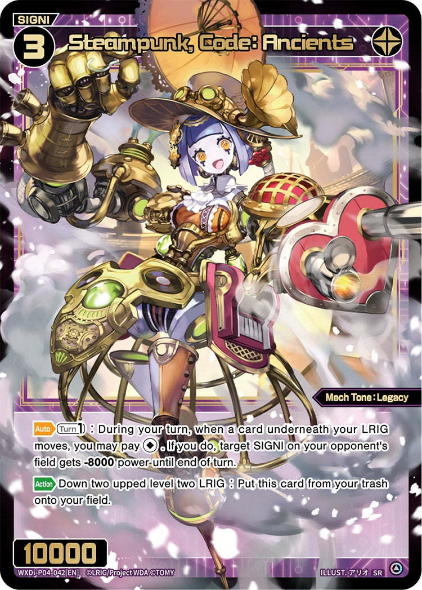

# Steampunk, Code: Ancients

## Thông tin lá

| Trường | Giá trị |
| --- | --- |
| Mã in | WXDi-P04-042[EN] |
| Set | WXDi-P04[EN] |
| Số thứ tự | 042 |
| Loại thẻ | SIGNI |
| Vị trí | Main Deck |
| Số bản | — (set booster, không áp dụng) |
| Màu | Đen |
| Độ hiếm | SR |
| Minh họa | アリオ |
| Level | 3 |
| Limit | — |
| Power | 10000 |
| LRIG type / Class | Mech Tone：Legacy |
| Team / Master | — |
| Cost | — |
| Grow cost | — |
| Use timing | — |
| Life Burst | Không |

## Card text chính thức

[Auto] {1/Turn}: During your turn, when a card underneath your LRIG moves, you may pay {Colorless}. If you do, target SIGNI on your opponent's field gets -8000 power until end of turn.

[Action] Down two upped level two LRIG: Put this card from your trash onto your field.

## Power text / Life Burst

—

## Ghi chú minh họa
Artist: アリオ. Ảnh SR được tải từ Card List tiếng Anh.

## FAQ chính thức

**Q. If I paid Exceed for the cost of any card or ability to play, does this SIGNI's [Auto] ability trigger?**
A. Yes, in that case it is still triggered because a card has been moved from underneath your LRIG.

## Nguồn
[Card List/FAQ chính thức](https://www.takaratomy.co.jp/products/en.wixoss/card/card.html?card_no=WXDi-P04-042%5BEN%5D ) · [Ảnh thẻ](https://www.takaratomy.co.jp/products/en.wixoss/card/thumb/WXDi-P04-042%5BEN%5D.jpg)
