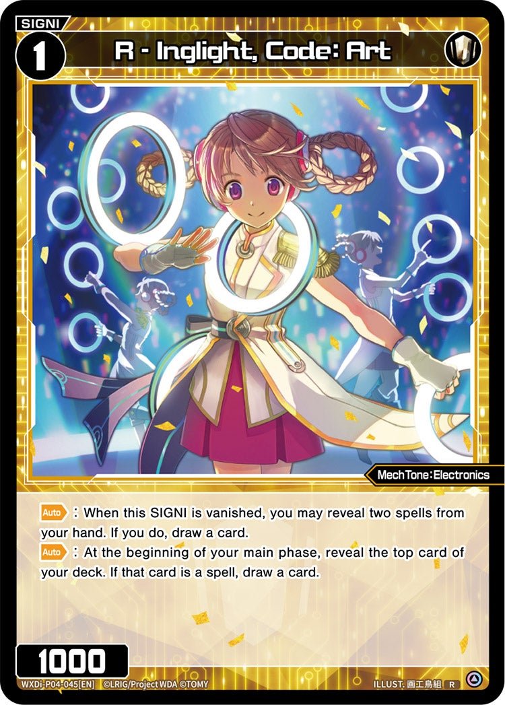

# R - Inglight, Code: Art

## Thông tin lá

| Trường | Giá trị |
| --- | --- |
| Mã in | WXDi-P04-045[EN] |
| Set | WXDi-P04[EN] |
| Số thứ tự | 045 |
| Loại thẻ | SIGNI |
| Vị trí | Main Deck |
| Số bản | — (set booster, không áp dụng) |
| Màu | Trắng |
| Độ hiếm | R,R(P) |
| Minh họa | 画工鳥組 |
| Level | 1 |
| Limit | — |
| Power | 1000 |
| LRIG type / Class | Mech Tone：Electronics |
| Team / Master | — |
| Cost | — |
| Grow cost | — |
| Use timing | — |
| Life Burst | Không |

## Card text chính thức

[Auto]: When this SIGNI is vanished, you may reveal two spells from your hand. If you do, draw a card.
[Auto]: At the beginning of your main phase, reveal the top card of your deck. If that card is a spell, draw a card.

## Power text / Life Burst

—

## Ghi chú minh họa
Artist: 画工鳥組. Ảnh R được tải từ Card List tiếng Anh.

## FAQ chính thức

**Q. If the card revealed by the second [Auto] ability is a Spell, Do I draw the revealed Spell by that effect?**
A. Yes, you draw a revealed Spell and put into you hand.

## Ảnh biến thể

- [R(P)](../images/WXDi-P04-045P-EN.jpg)

## Nguồn
[Card List/FAQ chính thức](https://www.takaratomy.co.jp/products/en.wixoss/card/card.html?card_no=WXDi-P04-045%5BEN%5D ) · [Ảnh thẻ](https://www.takaratomy.co.jp/products/en.wixoss/card/thumb/WXDi-P04-045%5BEN%5D.jpg)
