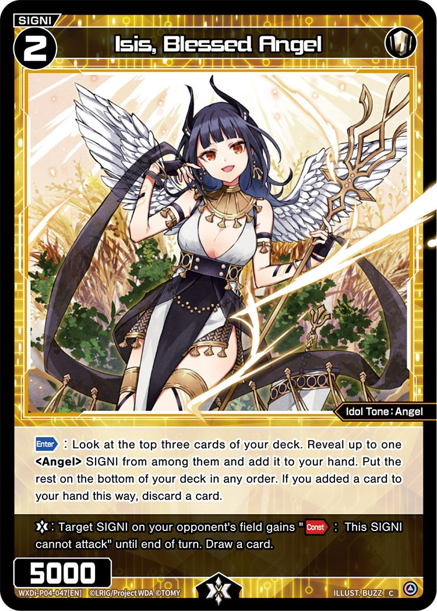

# Isis, Blessed Angel

## Thông tin lá

| Trường | Giá trị |
| --- | --- |
| Mã in | WXDi-P04-047[EN] |
| Set | WXDi-P04[EN] |
| Số thứ tự | 047 |
| Loại thẻ | SIGNI |
| Vị trí | Main Deck |
| Số bản | — (set booster, không áp dụng) |
| Màu | Trắng |
| Độ hiếm | C,C(P) |
| Minh họa | BUZZ |
| Level | 2 |
| Limit | — |
| Power | 5000 |
| LRIG type / Class | Idol Tone：Angel |
| Team / Master | — |
| Cost | — |
| Grow cost | — |
| Use timing | — |
| Life Burst | Có |

## Card text chính thức

[Enter]: Look at the top three cards of your deck. Reveal up to one <Angel> SIGNI from among them and add it to your hand. Put the rest on the bottom of your deck in any order. If you added a card to your hand this way, discard a card.

## Power text / Life Burst

Target SIGNI on your opponent's field gains "[Constant]: This SIGNI cannot attack" until end of turn. Draw a card.

## Ghi chú minh họa
Artist: BUZZ. Ảnh C được tải từ Card List tiếng Anh.

## FAQ chính thức

**Q. I look at the top three cards of my deck by this card's [Enter] ability. There was an <Angel> SIGNI among them, may I chose not reveal it?**
A. Yes, you can. In that case, you cannot add any card to your hand. Then you put three cards on the bottom of your deck in any order.

## Ảnh biến thể

- [C(P)](../images/WXDi-P04-047P-EN.jpg)

## Nguồn
[Card List/FAQ chính thức](https://www.takaratomy.co.jp/products/en.wixoss/card/card.html?card_no=WXDi-P04-047%5BEN%5D ) · [Ảnh thẻ](https://www.takaratomy.co.jp/products/en.wixoss/card/thumb/WXDi-P04-047%5BEN%5D.jpg)
