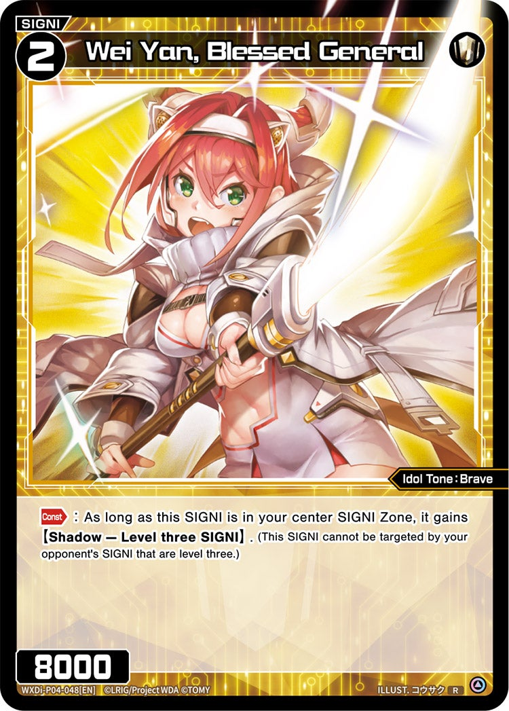

# Wei Yan, Blessed General

## Thông tin lá

| Trường | Giá trị |
| --- | --- |
| Mã in | WXDi-P04-048[EN] |
| Set | WXDi-P04[EN] |
| Số thứ tự | 048 |
| Loại thẻ | SIGNI |
| Vị trí | Main Deck |
| Số bản | — (set booster, không áp dụng) |
| Màu | Trắng |
| Độ hiếm | R,R(P) |
| Minh họa | コウサク |
| Level | 2 |
| Limit | — |
| Power | 8000 |
| LRIG type / Class | Idol Tone：Brave |
| Team / Master | — |
| Cost | — |
| Grow cost | — |
| Use timing | — |
| Life Burst | Không |

## Card text chính thức

[Constant]: As long as this SIGNI is in your center SIGNI Zone, it gains 【Shadow — Level three SIGNI】. (This SIGNI cannot be targeted by your opponent's SIGNI that are level three.)

## Power text / Life Burst

—

## Ghi chú minh họa
Artist: コウサク. Ảnh R được tải từ Card List tiếng Anh.

## FAQ chính thức

**Q. Is the [Shadow (SIGNI)] ability no longer targeted by a SIGNI's Life Burst ability?**
A. Yes, Life Burst can also be prevented from being targeted by this ability if it is Level three SIGNI.

## Ảnh biến thể

- [R(P)](../images/WXDi-P04-048P-EN.jpg)

## Nguồn
[Card List/FAQ chính thức](https://www.takaratomy.co.jp/products/en.wixoss/card/card.html?card_no=WXDi-P04-048%5BEN%5D ) · [Ảnh thẻ](https://www.takaratomy.co.jp/products/en.wixoss/card/thumb/WXDi-P04-048%5BEN%5D.jpg)
