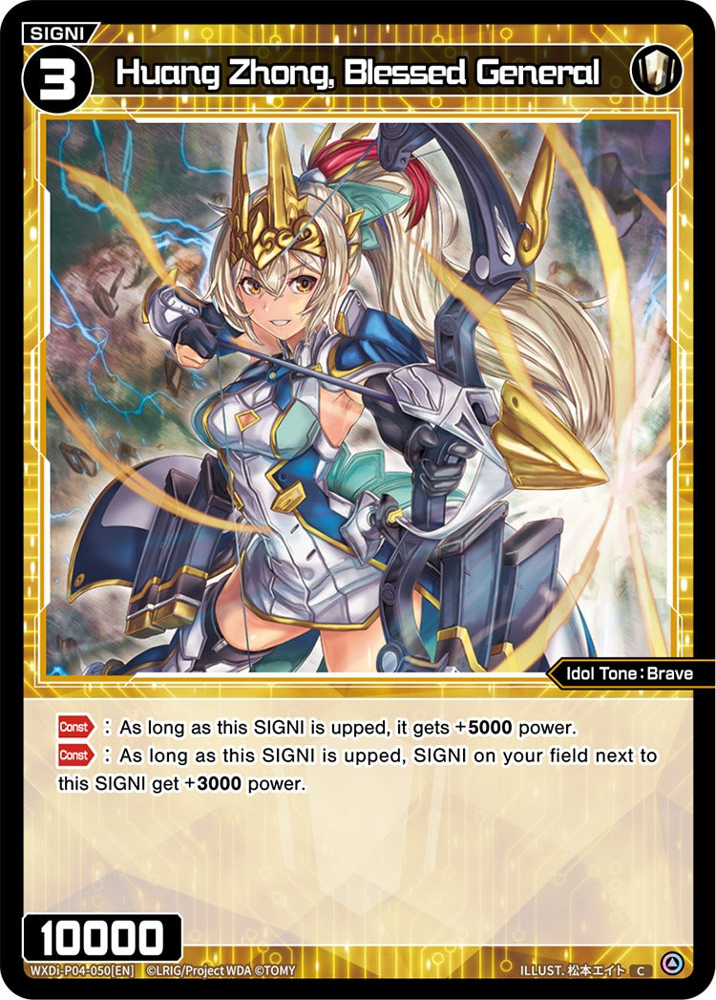

# Huang Zhong, Blessed General

## Thông tin lá

| Trường | Giá trị |
| --- | --- |
| Mã in | WXDi-P04-050[EN] |
| Set | WXDi-P04[EN] |
| Số thứ tự | 050 |
| Loại thẻ | SIGNI |
| Vị trí | Main Deck |
| Số bản | — (set booster, không áp dụng) |
| Màu | Trắng |
| Độ hiếm | C,C(P) |
| Minh họa | 松本エイト |
| Level | 3 |
| Limit | — |
| Power | 10000 |
| LRIG type / Class | Idol Tone：Brave |
| Team / Master | — |
| Cost | — |
| Grow cost | — |
| Use timing | — |
| Life Burst | Không |

## Card text chính thức

[Constant]: As long as this SIGNI is upped, it gets +5000 power.
[Constant]: As long as this SIGNI is upped, SIGNI on your field next to this SIGNI get +3000 power.

## Power text / Life Burst

—

## Ghi chú minh họa
Artist: 松本エイト. Ảnh C được tải từ Card List tiếng Anh.

## FAQ chính thức

**Q. The upped "Huang Zhong, Blessed General" is on the left SIGNI Zone and the other SIGNI is on the right SIGNI Zone. There is no SIGNI on the center SIGNI Zone. Does the SIGNI on the right SIGNI Zone get +3000 power?**
A. No, it cannot get +3000 power. "SIGNI on your field next to this SIGNI" means "SIGNI on the SIGNI Zone on your field next to this SIGNI". When the upped "Huang Zhong, Blessed General" is on the left SIGNI Zone, "SIGNI on your field next to this SIGNI" is a SIGNI on the center SIGNI Zone.

## Ảnh biến thể

- [C(P)](../images/WXDi-P04-050P-EN.jpg)

## Nguồn
[Card List/FAQ chính thức](https://www.takaratomy.co.jp/products/en.wixoss/card/card.html?card_no=WXDi-P04-050%5BEN%5D ) · [Ảnh thẻ](https://www.takaratomy.co.jp/products/en.wixoss/card/thumb/WXDi-P04-050%5BEN%5D.jpg)
