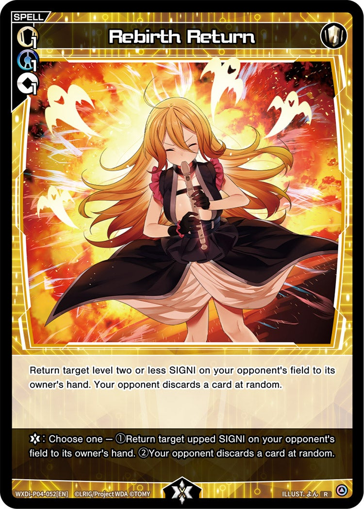

# Rebirth Return

## Thông tin lá

| Trường | Giá trị |
| --- | --- |
| Mã in | WXDi-P04-052[EN] |
| Set | WXDi-P04[EN] |
| Số thứ tự | 052 |
| Loại thẻ | SPELL |
| Vị trí | Main Deck |
| Số bản | — (set booster, không áp dụng) |
| Màu | Trắng |
| Độ hiếm | R,R(P) |
| Minh họa | よん |
| Level | — |
| Limit | — |
| Power | 0 |
| LRIG type / Class | — |
| Team / Master | — |
| Cost | 《W》×１ / 《U》×１ / 《C》×１ |
| Grow cost | — |
| Use timing | — |
| Life Burst | Có |

## Card text chính thức

Return target level two or less SIGNI on your opponent's field to its owner's hand. Your opponent discards a card at random.

## Power text / Life Burst

Choose one — ①Return target upped SIGNI on your opponent's field to its owner's hand. ②Your opponent discards a card at random.

## Ghi chú minh họa
Artist: よん. Ảnh R được tải từ Card List tiếng Anh.

## FAQ chính thức

**Q. When my opponent no cards in my opponent's hand, I played this Spell. What happens?**
A. In that case, return target level two or less SIGNI on your opponent's field to its owner's hand, then discard that SIGNI.

## Ảnh biến thể

- [R(P)](../images/WXDi-P04-052P-EN.jpg)

## Nguồn
[Card List/FAQ chính thức](https://www.takaratomy.co.jp/products/en.wixoss/card/card.html?card_no=WXDi-P04-052%5BEN%5D ) · [Ảnh thẻ](https://www.takaratomy.co.jp/products/en.wixoss/card/thumb/WXDi-P04-052%5BEN%5D.jpg)
